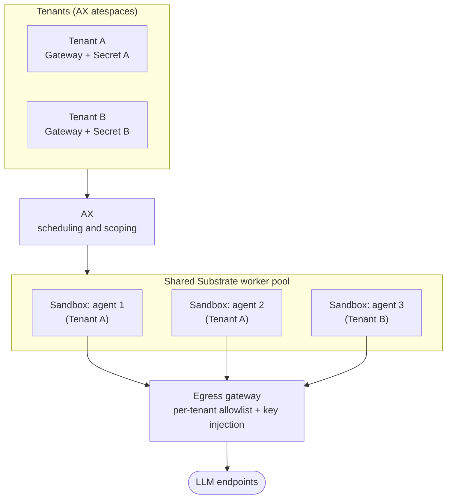

# AX Agent Sandbox

Run coding tasks from multiple AI agents on shared infrastructure, safely and efficiently, in a multi-tenant environment.

This project shows how three layers work together:

| Layer                 | Component                                                       | Role                                                                                          |
| --------------------- | --------------------------------------------------------------- | --------------------------------------------------------------------------------------------- |
| Isolation and runtime | [Agent Substrate](https://github.com/agent-substrate/substrate) | Runs each agent in a gVisor sandbox on a shared worker pool, and checkpoints and restores it. |
| Orchestration         | [Google AX](https://github.com/google/ax)                       | Schedules tasks and scopes tasks, gateways, workspaces and models by tenant (atespace).       |
| Agents                | [OpenCode](https://opencode.ai) and other headless CLI agents   | Do the coding work against any OpenAI-compatible or Anthropic-format LLM endpoint.            |

The scripts, manifests and images build the whole stack on a local [kind](https://kind.sigs.k8s.io) cluster,
so you can see the pieces interact before you move to a shared cluster.



## Why use it

| Benefit                            | How it works                                                                                                                            |
| ---------------------------------- | --------------------------------------------------------------------------------------------------------------------------------------- |
| **Many agents, shared capacity**   | Sandboxes share a worker pool. Idle tasks can be suspended and checkpointed, then resumed, so capacity goes to agents that are working. |
| **Tenant separation**              | AX scopes tasks, gateways, workspaces and models by atespace, and each Gateway carries its own allowlist and credential reference.      |
| **Credentials never reach agents** | Each agent holds a placeholder. The egress gateway swaps in the tenant's real key from a Kubernetes Secret on the way out.              |
| **Strong isolation**               | Every task runs in a gVisor sandbox, so agent-run commands do not touch the host or neighbouring agents.                                |
| **Network control**                | An agent reaches only the hosts its Gateway lists. Everything else is refused.                                                          |
| **Durable work**                   | `/workspace` survives suspend and resume, so a task continues where it stopped.                                                         |
| **Agent-agnostic**                 | OpenCode is the reference agent. Another headless CLI agent needs only a new image and command.                                         |
| **Bring your own model**           | Works with any endpoint that speaks the OpenAI chat or Anthropic messages format.                                                       |
| **Token savers**                   | Prebuilt integrations for rtk, Headroom, Engram and Graphify, with measured results.                                                    |

## What it is good for

- Learning how Substrate, AX and coding agents fit together.
- Prototyping a shared agent platform with per-tenant credentials and network policy.
- Running agents on untrusted code without exposing keys or the host.
- Measuring agent behavior and token cost under controlled conditions.

## What is included

| Capability                                                            | Status                                                                                  |
| --------------------------------------------------------------------- | --------------------------------------------------------------------------------------- |
| Task runs in a gVisor sandbox on kind                                 | Verified                                                                                |
| Custom agent image from a local registry                              | Verified                                                                                |
| Real API key injected at egress, sandbox sees only a placeholder      | Verified (mock and real gateway)                                                        |
| Hosts outside the Gateway allowlist are refused                       | Verified                                                                                |
| `/workspace` state survives suspend and resume                        | Verified                                                                                |
| OpenCode completes prompts through the injected key                   | Verified                                                                                |
| Token-saving tools (rtk, Headroom, Engram, Graphify)                  | Verified to run; savings vary by workload                                               |
| Several agents running concurrently on the shared pool                | Verified with a real provider; full workflow recovered after a mutation retry           |
| Tenant separation across atespaces (separate keys, credential policy) | Verified (2 atespaces)                                                                  |
| Long-running sessions on large repositories                           | Not tested                                                                              |
| Memory shared across tasks                                            | Not tested                                                                              |
| Evaluation-gated agent/skill/tool-use instruction updates             | Verified on three bounded decision suites; one skill promoted and OpenCode smoke passed |

The [real-provider team run](docs/how-to/run-team-demo.md#real-provider-recovered-run-2026-11-25)
completed all stages after a targeted mutation retry, including reviewers and isolation checks.
It was not a clean unattended run, and the generated epic did not pass its quality gates.
See [Multi-agent and multi-tenant design](docs/explanation/multi-agent-multitenancy.md) for how the pieces map and what a test needs.

## Quickstart

You need Podman or Docker (6 GiB RAM or more for the VM), `kind`, `kubectl`, `curl` and `envsubst`.
Run from the project root:

```bash
scripts/00-preflight.sh --fix
scripts/01-install-ax.sh
export PATH="$HOME/.ax/bin:$PATH"
scripts/02-start-cluster.sh        # first start pulls about 570 MB
scripts/05-mock-llm.sh
scripts/03-build-push-image.sh
scripts/09-git-server.sh
scripts/10-team-demo.sh            # one epic: triage, builders, mutation, then reviewers
scripts/99-teardown.sh
```

For the full sequence in one command, use `scripts/main.sh`.
To skip the local image build, run `IMAGE_SOURCE=external OPENCODE_IMAGE=registry.example/agent@sha256:<digest> scripts/main.sh`
with a compatible, worker-accessible image; the demo fetches the Click seed repository at tag `8.1.8`
when `image/sample-repo/` is absent.

The demo shows each agent's output, the placeholder key in the sandbox, and the mock LLM receiving each tenant's own key.
For a guided walkthrough, follow the [first-task tutorial](docs/tutorials/first-task.md).
To use a real model, see [Use a real LLM endpoint](docs/how-to/use-real-llm-endpoint.md).
To use an external Ollama server, see [Run the team demo with Ollama](docs/how-to/run-team-demo-with-ollama.md).

## Token-saving tools

| Tool                                                          | What it does                        | Measured effect                                                      |
| ------------------------------------------------------------- | ----------------------------------- | -------------------------------------------------------------------- |
| [Graphify](docs/how-to/enable-token-saving-tools.md#graphify) | Code knowledge graph for navigation | About 28% fewer tokens, 58% fewer tool calls (older single run)      |
| [Headroom](docs/how-to/enable-token-saving-tools.md#headroom) | Context-compression proxy           | 69.4% fewer input tokens on synthetic JSON history                   |
| [rtk](docs/how-to/enable-token-saving-tools.md#rtk)           | Shell output compression            | 93.2% fewer input tokens on verbose pytest; 0% on ten-commit Git log |
| [Engram](docs/how-to/enable-token-saving-tools.md#engram)     | Persistent memory over MCP          | Recall across sessions works; adds tool-definition overhead          |

The rtk and Headroom results are from three paired requests per workload on 2026-11-25;
all 18 answer checks passed. They measure bounded context compression, not whole-agent savings.
Savings depend on the workload.
Read the [findings](docs/explanation/token-saving-findings.md) before you adopt one.

## Self-improving definitions

The [self-improvement loop](docs/how-to/self-improve-agent-definitions.md)
reflects on training failures, evaluates additive instruction changes on frozen
holdout scenarios, and promotes only improvements without paired regressions.
It runs in AX sandboxes and updates role, skill and tool-use Markdown definitions
only with explicit opt-in.

The first admitted evidence skill improved from 8/12 to 10/12 exact answers;
a regressing role change and a no-gain tool change were rejected.
See the [measured findings](docs/explanation/self-improvement-findings.md) and
[369-entry resource review](docs/explanation/self-improvement-catalog.md).
This is instruction-layer optimization, not model training or proven
end-to-end coding improvement.

## Python development

Use Python 3.10 or newer and an isolated development environment:

```bash
python3 -m venv .venv
.venv/bin/python -m pip install -r requirements-dev.txt
make format-python
make check-python
```

Black formats code, isort orders imports using Black's profile, and Ruff checks
Python errors, modern syntax and Google-style docstrings.
All three use an 88-character formatting width.
Test methods use descriptive names rather than mandatory docstrings.
`make check-python` runs these checks and the existing unittest suite, including
doctest examples from script docstrings.
Those examples exercise pure decision and metric helpers without contacting a
cluster, model provider or git server.
The same checks run in GitHub Actions.

Run only tests without development dependencies:

```bash
python3 -m unittest discover -s tests -p 'test_*.py'
```

Historical run receipts retain their original hashes; formatting and docstring
changes affect the provenance hashes of future runs only.

## Documentation

| Section     | Pages                                                                                                                                                                                                                                                                                                                                                                                                                                                      |
| ----------- | ---------------------------------------------------------------------------------------------------------------------------------------------------------------------------------------------------------------------------------------------------------------------------------------------------------------------------------------------------------------------------------------------------------------------------------------------------------- |
| Tutorial    | [Run your first sandboxed task](docs/tutorials/first-task.md)                                                                                                                                                                                                                                                                                                                                                                                              |
| How-to      | [Real LLM endpoint](docs/how-to/use-real-llm-endpoint.md), [Private CA](docs/how-to/trust-private-ca.md), [Token-saving tools](docs/how-to/enable-token-saving-tools.md), [Another agent](docs/how-to/plug-in-another-agent.md), [Team demo](docs/how-to/run-team-demo.md), [Team demo with Ollama](docs/how-to/run-team-demo-with-ollama.md), [Git server](docs/how-to/host-repositories-with-git-server.md), [Troubleshoot](docs/how-to/troubleshoot.md) |
| Reference   | [Scripts and configuration](docs/reference/scripts-and-configuration.md)                                                                                                                                                                                                                                                                                                                                                                                   |
| Explanation | [How it all works together](docs/explanation/how-it-works-end-to-end.md), [How AX and Substrate work together](docs/explanation/ax-and-substrate.md), [Architecture](docs/explanation/architecture.md), [Multi-agent and multi-tenant design](docs/explanation/multi-agent-multitenancy.md), [Credential injection](docs/explanation/credential-injection.md), [Token-saving findings](docs/explanation/token-saving-findings.md)                          |

## Project layout

```text
scripts/     numbered setup and run scripts
resources/   Kubernetes and AX YAML as kustomizations (mock-llm, git-server, headroom, team, task)
agents/      agent definitions: the epic, team rules, one file per role, ci-check
skills/      reusable instruction skills consumed by the team runner
tools/       tool-use contracts (not new executables)
evaluations/ frozen optimization suites and validation-only replay cases
image/       Dockerfile (one file, all agent tools) and agent configs
docs/        tutorials, how-to guides, reference, explanation
```

Git ignores `certs/`, `.env.*`, the `rtk` and `engram` binaries, `image/opencode.local.json`,
`image/sample-repo/` and `image/graph/`.

## Limitations

- **Alpha dependencies.** AX is `v0.4.0-rc.1` (API `v1alpha1`) and Substrate is `v1.0.0`.
  The scripts pin both, and the APIs may change.
- **Header-based auth only.** Key injection replaces HTTP headers on `https` rules with a specific host.
- **No runtime installs.** The sandbox has no registry access, so bake every dependency into the image.
- **Local scale.** The setup targets one machine, not a multi-node cluster, and fixed task names per demo run.
- **Proxies see the key.** A proxy on the request path, such as Headroom, receives the real key.
