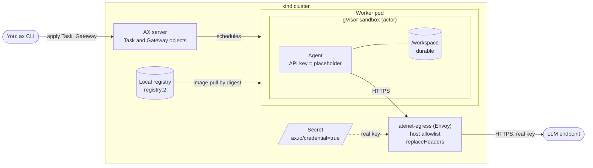
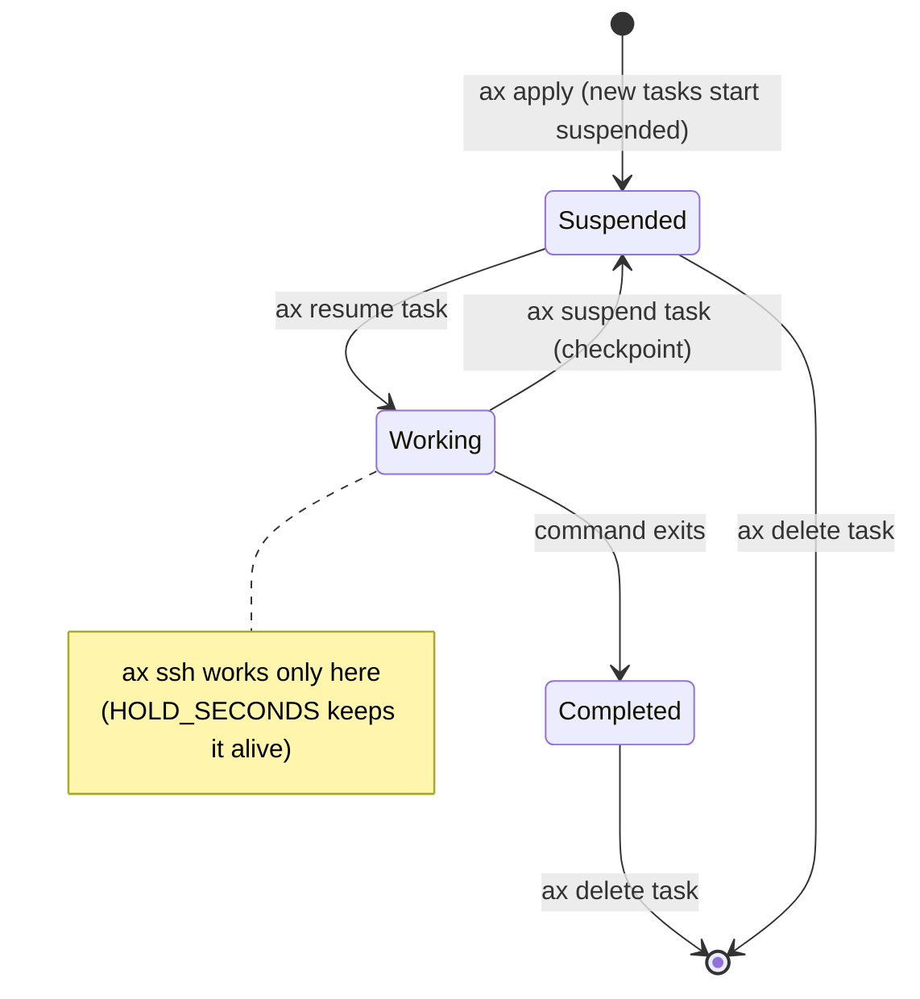

# Architecture

This page explains how the pieces fit together and why the design looks the way it does.

## Components

The dotted lines are control-plane or one-time flows.
Solid lines carry agent traffic.

| Component       | Role                                                                    |
| --------------- | ----------------------------------------------------------------------- |
| kind            | Local Kubernetes cluster, running on Podman or Docker.                  |
| Agent Substrate | Runs actors in gVisor sandboxes and checkpoints them.                   |
| AX              | Schedules tasks and exposes the `ax` CLI.                               |
| Task            | Your image and command, run as a sandboxed actor.                       |
| Gateway         | The hosts an actor may reach and the headers to inject.                 |
| `atenet-egress` | Envoy proxy that enforces the Gateway and terminates TLS.               |
| Local registry  | A `registry:2` container on the `kind` network that serves task images. |

## Key design points

**Actors are not pods.**
A sandbox runs inside a worker pod, so Kubernetes `secretKeyRef` and volume mounts do not reach it.
This is why secrets arrive through the egress gateway instead.

**All traffic leaves through one gateway.**
The sandbox has no other route out.
A host outside the allowlist is refused, which also blocks runtime package downloads.
Every dependency must be in the image.

**The gateway terminates TLS.**
It must be able to read the headers to replace them.
So the sandbox trusts the gateway CA, and the gateway must trust the upstream CA.
See [Trust a private CA](../how-to/trust-private-ca.md).

**`/workspace` is durable.**
Suspending and resuming a task restores it.
The agent keeps its home directory and any memory store there.

**Task specs are immutable and images are pinned by digest.**
To change a task, delete and reapply it.
`03-build-push-image.sh` writes the digest for you.

## Task lifecycle

A task moves between running and suspended.
Suspending checkpoints the sandbox and `/workspace`, and resuming restores them.
The diagram is simplified: it shows the states you see in normal use.

The diagram is simplified.
For the full state list and how AX maps to Substrate, see [How AX and Agent Substrate work together](ax-and-substrate.md).

## Why a local registry

`ax local` creates no registry, and the atelet pulls task images itself.
The scripts run `registry:2` on the `kind` network and refer to it by private IP.
The pull uses plain HTTP for private addresses.

## Related

- [How AX and Agent Substrate work together](ax-and-substrate.md)
- [Credential injection](credential-injection.md)
- [Scripts and configuration reference](../reference/scripts-and-configuration.md)
