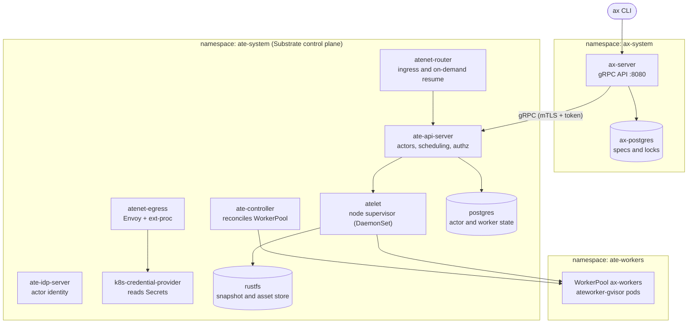
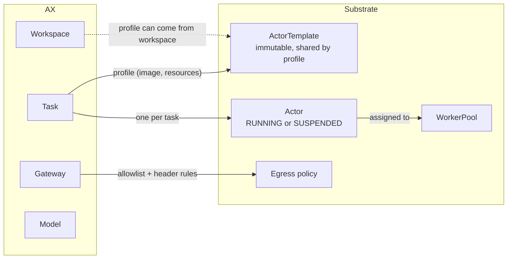
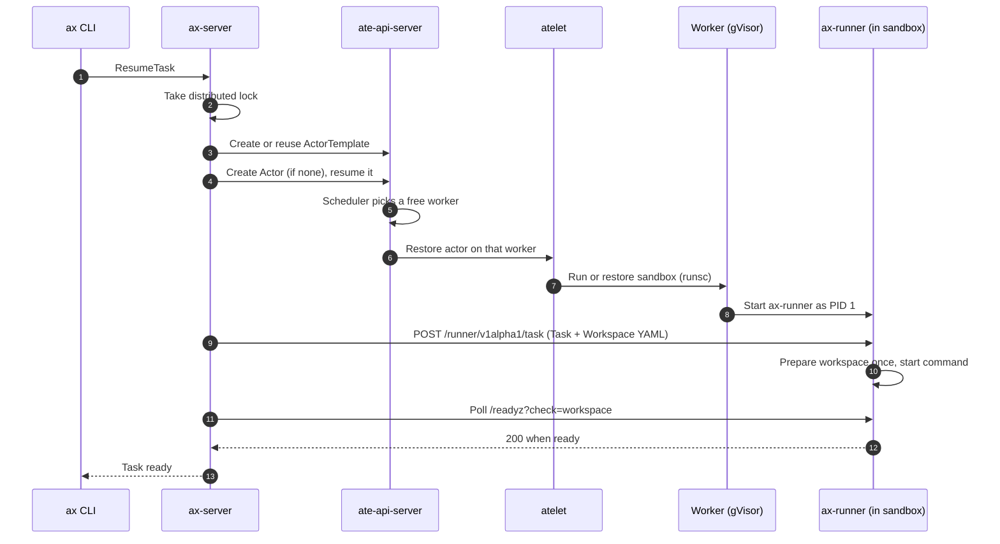
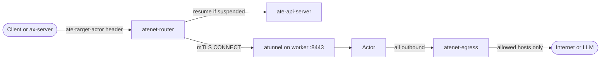

# How AX and Agent Substrate work together

This page explains in detail how Google AX and Agent Substrate divide the work of running an agent task.
It combines the upstream design documents with what this project's cluster shows.

Versions: AX `v0.4.0-rc.1` (API `ax.io/v1alpha1`) and Agent Substrate `v1.0.0`.
Both evolve, and the upstream `main` branch documents newer behavior than these versions in places.
Where this page describes something seen only in this project's cluster, it says so.

## The short version

- **Substrate** is the runtime. It runs untrusted workloads (actors) in gVisor sandboxes on a pool of pre-started worker pods.
  It can snapshot an idle actor out of memory and restore it onto any free worker.
- **AX** is the orchestrator on top. You declare a `Task`, `Workspace`, `Gateway` or `Model`, and AX turns them into Substrate actors and keeps its own records.
- **The agent** (OpenCode here) is just a program inside the sandbox. Neither layer knows it is an AI agent.

| Question                                           | Answered by                                               |
| -------------------------------------------------- | --------------------------------------------------------- |
| What does the user declare?                        | AX: `Task`, `Workspace`, `Gateway`, `Model`               |
| Where is the declaration stored?                   | AX: its own PostgreSQL database                           |
| What actually runs?                                | Substrate: an actor in a gVisor sandbox on a worker pod   |
| How is it isolated and snapshotted?                | Substrate: `atelet`, `ateworker` and `runsc`              |
| How does traffic get in and out?                   | Substrate: `atenet-router` (in) and `atenet-egress` (out) |
| Who prepares the workspace and starts the command? | AX: `ax-runner`, inside the sandbox                       |

## What runs in the cluster

These are the components in this project's kind cluster, grouped by namespace.

| Component                                         | Namespace     | What it does                                                                                                  |
| ------------------------------------------------- | ------------- | ------------------------------------------------------------------------------------------------------------- |
| `ax-server`                                       | `ax-system`   | AX control plane. Validates manifests, takes locks, and reconciles with Substrate.                            |
| `ax-postgres`                                     | `ax-system`   | Stores AX resources and the leases behind its distributed locks.                                              |
| `ate-api-server`                                  | `ate-system`  | Substrate control plane. Holds the actor-to-worker mapping, schedules, and authorizes each call per atespace. |
| `ate-controller`                                  | `ate-system`  | Turns `WorkerPool` custom resources into worker Deployments.                                                  |
| `atelet`                                          | `ate-system`  | Per-node supervisor. Restores, runs and checkpoints sandboxes, and moves snapshots.                           |
| `atenet-router`                                   | `ate-system`  | Ingress proxy. Resumes a suspended actor when traffic arrives.                                                |
| `atenet-egress`                                   | `ate-system`  | Egress proxy. Enforces the allowlist and injects credentials.                                                 |
| `ate-idp-server`                                  | `ate-system`  | Issues identity to actors.                                                                                    |
| `k8s-credential-provider`                         | `ate-system`  | Reads Kubernetes Secrets for credential injection.                                                            |
| `postgres`                                        | `ate-system`  | Substrate state store for actors and workers.                                                                 |
| `rustfs`                                          | `ate-system`  | S3-compatible object store for snapshots and sandbox assets.                                                  |
| `ax-workers` pods                                 | `ate-workers` | Warm worker pods that host sandboxes.                                                                         |
| `jaeger`, `prometheus`, `opentelemetry-collector` | `otel-system` | Traces and metrics.                                                                                           |

Two PostgreSQL databases exist on purpose.
Substrate's holds the live state of actors and workers.
AX's holds only what AX owns: specs, metadata and the parts of status that describe AX's own work.
AX reads everything about an actor's live state from Substrate each time you fetch a task, so the two never drift.

## Why two layers

Substrate avoids storing millions of short-lived objects in Kubernetes (etcd).
It keeps infrastructure objects in Kubernetes and high-churn state in PostgreSQL:

| Kind                                    | Examples                                | Where it lives              |
| --------------------------------------- | --------------------------------------- | --------------------------- |
| Infrastructure (declarative, low churn) | `WorkerPool`, `SandboxConfig`           | Kubernetes custom resources |
| Workload definition                     | `ActorTemplate`                         | Substrate API and database  |
| Live state (high churn)                 | `Actor`, `Worker`, `ActorAssignment`    | Substrate database          |
| User-facing declarations                | `Task`, `Workspace`, `Gateway`, `Model` | AX database                 |

AX adds the agent-oriented layer above that: a workspace to prepare, a command to run, a gateway for network policy, and a simple verb set (`apply`, `resume`, `suspend`, `ssh`).

## How AX objects map to Substrate objects

| AX object                         | Becomes in Substrate                                | Notes                                                                                       |
| --------------------------------- | --------------------------------------------------- | ------------------------------------------------------------------------------------------- |
| `Task`                            | An **Actor**, one per task                          | Seen here: `ax describe task` shows an `Actor` name and UID.                                |
| Task profile (`image`, resources) | An **ActorTemplate**                                | Tasks with the same profile share one template. Seen here as `Template: default/ax-<hash>`. |
| `Workspace`                       | A durable `/workspace` volume, plus a "setup" actor | The setup actor prepares the workspace once, then is snapshotted.                           |
| `Gateway`                         | Egress rules in `atenet-egress`                     | Host allowlist and `replaceHeaders` rules.                                                  |
| `Model`                           | Nothing in Substrate                                | AX components read it. It holds a provider config and a Secret reference.                   |
| atespace                          | Substrate **atespace**                              | The tenant boundary. Substrate authorizes every call per atespace.                          |

Two consequences follow from tasks sharing a template.
The container starts without knowing which task it runs, so AX pushes the task to it after the actor is up (see below).
And the image must be pinned by digest, because a template is immutable.

## Lifecycle of a task

### Apply creates a record, not a process

`ax apply` stores the `Task` in AX's database.
A new task starts **suspended**: no sandbox exists yet, and AX marks it not ready.

### Resume provisions and starts the actor

Details that matter:

- **Scheduling is Substrate's.**
  A pre-started worker pod takes the actor, so there is no Kubernetes pod scheduling on the hot path.
  With no worker pool, resume fails with `no free workers available`.
- **The runner is always PID 1.**
  AX starts every task container with `/usr/local/bin/ax-runner`.
  Prebuilt agent images contain no runner, so AX supplies one from a runner volume image (`AX_RUNNER_VOLUME_IMAGE`).
  Your command in `spec.commands` reaches the runner only through the push in step 9, and the runner starts it.
- **The push repeats on every resume.**
  The runner replies `200` if it already holds the same task, so resuming a restored sandbox does not restart work it already has.
- **Workspace setup runs once.**
  The runner records a marker on the durable volume and skips setup on later boots.
  Without it, a resume would re-clone into a restored workspace and destroy the agent's state.

### Suspend checkpoints state

`ax suspend task` asks Substrate to snapshot the actor.
`atelet` asks the worker's `runsc` to checkpoint the sandbox, then uploads the snapshot to the object store.
The worker is free for another actor.
Resume restores the latest snapshot, possibly on a different worker.

| Snapshot content               | Survives suspend and resume                                                                      |
| ------------------------------ | ------------------------------------------------------------------------------------------------ |
| `/workspace` (durable volume)  | Yes                                                                                              |
| Files elsewhere in the sandbox | Depends on the snapshot type                                                                     |
| Process memory                 | Substrate can capture it. AX documents that the runner sees a **new process tree** after resume. |
| Your agent's in-memory session | Plan for it to restart. Keep state under `/workspace`.                                           |

The last two rows describe AX's documented behavior.
This project verified only that `/workspace` files persist across suspend and resume.

### Delete tears down

`ax delete task` removes the actor on Substrate and the AX record.
The command blocks until teardown finishes.

## Task states

AX reports a task's state as the actor's Substrate state, plus one state of its own:

| State                        | Meaning                                                            |
| ---------------------------- | ------------------------------------------------------------------ |
| Queued (AX)                  | The actor is not provisioned yet.                                  |
| Suspended                    | A snapshot exists, or the task is new, and no worker is held.      |
| Resuming                     | The actor is being restored onto a worker.                         |
| Running                      | The actor is on a worker. This CLI version prints it as `Working`. |
| Suspending                   | A checkpoint is in progress.                                       |
| Crashed, Reverting, Deleting | Failure and teardown states.                                       |

Two conditions carry the detail: `WorkspaceReady` and `Ready`.
Wait on `Ready`.
The API names states `TASK_STATE_*`, and the CLI shortens them (`TASK_STATE_COMPLETED` prints as `Completed`).
See [AX CLI output reference](../reference/ax-cli-output.md) for real output.

## Networking

- **Inbound.**
  An actor has no direct inbound path.
  Traffic reaches it only through `atenet-router`, which names the target as `<atespace>/<actor>` in a header.
  If the actor is suspended, the router asks the control plane to resume it before forwarding.
  AX uses this path to push the task to the runner.
- **Outbound.**
  Default-deny.
  `atenet-egress` allows only hosts in the actor's `Gateway`, terminates TLS, and can replace headers with values from a Secret.
  See [Credential injection](credential-injection.md).
- **No lateral access.**
  Actors cannot reach each other or the control plane.

## Identity, authorization and tenancy

- Each running actor gets a short-lived identity certificate that carries the actor and its atespace.
  The actor itself never holds it.
- `ate-api-server` authenticates every call and authorizes it per atespace.
  `ax-server` calls it with a service token and a CA bundle (see its `--substrate-token-file` and `--substrate-ca-file` flags).
- Every AX resource lives in an atespace, and `ax --atespace <name>` scopes a command to one.

Upstream treats every actor as untrusted and mutually hostile, so tenants can share physical nodes.
This project ran two atespaces side by side, and each tenant's key stayed separate.
See [Multi-agent and multi-tenant design](multi-agent-multitenancy.md).

## What this project adds on top

| Piece                                                   | Why it exists                                                                            |
| ------------------------------------------------------- | ---------------------------------------------------------------------------------------- |
| `02b-fix-gvisor-asset.sh`                               | Puts the gVisor assets in the in-cluster object store when the public bucket is blocked. |
| Local registry on the `kind` network                    | `atelet` pulls task images itself, and `ax local` creates no registry.                   |
| `05-mock-llm.sh` and the `egress-upstream-ca` ConfigMap | Makes `atenet-egress` trust a private upstream CA.                                       |
| `Gateway` with `replaceHeaders` in the task template    | Injects the key without the sandbox seeing it.                                           |
| OpenCode image                                          | Provides the agent and the `AGENTS` instruction files.                                   |

## Open questions

- How many actors one worker can host at the same time. The team demo used three worker pods.
- Whether an OpenCode task restores on a different worker after suspend. The worker was not recorded.
- How the `Gateway` reaches the egress proxy at runtime. The effect (allowlist and injection) is verified, the wiring is not traced.

## Sources

- [Agent Substrate architecture](https://github.com/agent-substrate/substrate/blob/main/docs/concepts/architecture.md)
- [AX design](https://github.com/google/ax/blob/main/DESIGN.md), [concepts](https://github.com/google/ax/blob/main/docs/concepts.md) and [runner contract](https://github.com/google/ax/blob/main/docs/runner.md)
