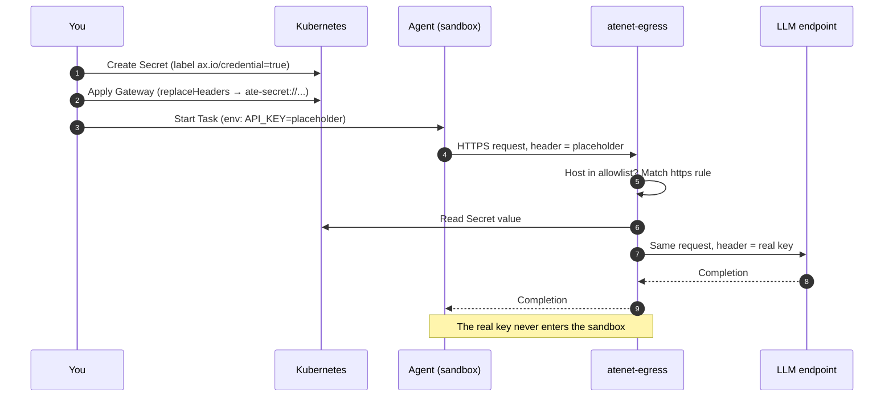

# Credential injection

This page explains how the sandbox calls an LLM without ever holding the real API key.

## The problem

A coding agent needs an API key.
If the key sits in the sandbox environment or on its disk,
a prompt-injected or misbehaving agent can read and leak it.

## The approach

1. You store the real key in a Kubernetes Secret labeled `ax.io/credential=true`.
2. The Task gives the agent only a placeholder value.
3. The Gateway has an `https` rule for the LLM host with `replaceHeaders`.
   The rule points to the Secret with a reference such as
   `ate-secret://k8s.io/default/<namespace>/<secret>/<key>`.
   The first `default` is fixed: only Secrets in the local cluster are supported.
4. When the agent sends a request, the egress gateway replaces the header with the real key
   and forwards the request.

The agent sees `placeholder` everywhere, including in `env` and its config files.

A request to a host outside the allowlist stops at step 5.

## Constraints

- The rule must be `https` and name a specific host. Wildcards cannot inject.
- Only headers can be replaced. Auth that uses a query string or a signed body does not fit.
- Each header the client sends needs its own rule.
  The Anthropic SDK sends both `x-api-key` and, in some setups, `Authorization`.
  If one carries an unreplaced placeholder, the endpoint rejects it.

## Alternatives considered

| Method                                  | Why not                                             |
| --------------------------------------- | --------------------------------------------------- |
| `secretKeyRef` or mounted Secret volume | Not available: actors are not pods.                 |
| `spec.env`                              | The key appears in plain text in the Task spec.     |
| Workspace `setup.files`                 | The key appears in the manifest and in snapshots.   |
| `Model.spec.secretKey`                  | Designed for AX-managed runners, not custom images. |
| Write a file with `ax ssh`              | Manual, not repeatable, and the agent can read it.  |

## Limits of the protection

The sandbox never sees the key, but anything on the request path does.
If you route traffic through a proxy such as Headroom, that proxy sees the real key.
The agent can still misuse the access the key grants, for example by sending prompts.
Keep the Gateway allowlist narrow.

## Verified behaviour

- The sandbox environment contained only `placeholder`.
- The mock LLM logged the real key in `Authorization`.
- A real Anthropic-format gateway returned a completion for a request that carried a placeholder.
- A request to a host outside the allowlist was refused.
