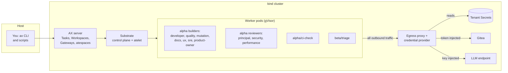
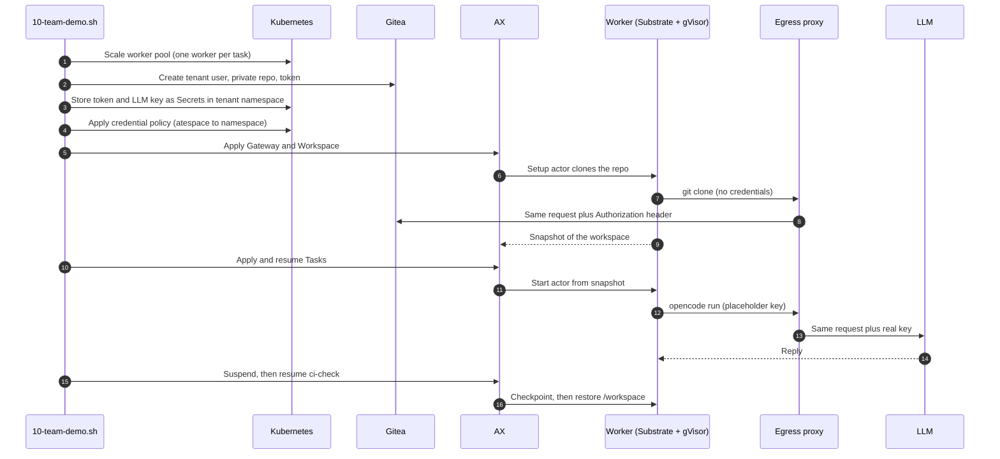

# How it all works together: a walkthrough of the team demo

This page follows one run of [`scripts/10-team-demo.sh`](../../scripts/10-team-demo.sh) from the first command to the last output.
It shows what each technology does at each step, and why the pieces are arranged this way.

For the object model, see [How AX and Substrate work together](ax-and-substrate.md).
For the role of each component, see [Components and roles](../reference/components-and-roles.md).
This page connects them in time.

## The technologies, in one table

| Technology                           | Job in this project                                                          | Where you see it                          |
| ------------------------------------ | ---------------------------------------------------------------------------- | ----------------------------------------- |
| `kind` and Podman                    | A local Kubernetes cluster to host everything                                | `scripts/02-start-cluster.sh`             |
| Agent Substrate                      | Runs each agent as an actor in a gVisor sandbox, with checkpoint and restore | Worker pods in `ate-workers`              |
| gVisor                               | The sandbox boundary around each agent                                       | The runtime of every task                 |
| AX                                   | The API and CLI: Tasks, Workspaces, Gateways, atespaces                      | `ax apply`, `ax get tasks`                |
| Egress proxy and credential provider | Enforces the host allowlist and injects credentials outside the sandbox      | Gateway rules, `ate-system` namespace     |
| Kubernetes Secrets                   | Hold the real LLM key and git token per tenant                               | `tenant-alpha`, `tenant-beta` namespaces  |
| Gitea (stands in for Forgejo)        | Hosts each tenant's private repository                                       | `git.default.svc.cluster.local`           |
| OpenCode                             | The coding agent that calls the LLM                                          | `opencode run` inside the sandbox         |
| rtk, Engram, Graphify                | Token-saving tools: command compression, memory, code graph                  | `image/AGENTS.md`, `image/opencode*.json` |
| Mock LLM (or a real endpoint)        | Answers model requests and logs the key it received                          | `mock-llm` Deployment                     |

## The big picture

The one idea to hold on to:
**an agent can only talk to the network through the egress proxy, and the proxy adds the credentials.**
Everything else follows from that.

## Step by step

### 1. Capacity: scale the worker pool (step 1)

Substrate runs actors on worker pods.
The script reserves `ax-workers` capacity from the initial task and builder roster (10 workers by default, overridable with `WORKERS`).
Each worker hosts sandboxed actors; the control plane decides which worker takes which actor.

### 2. Tenants: users, repositories and Secrets (steps 2 to 4)

For each tenant (`alpha`, `beta`) the script:

1. Creates a Gitea user, a private `app` repository and a token with `write:repository` scope.
2. Creates a Kubernetes namespace `tenant-<name>` and stores two Secrets there: `git-token` and `llm-key`.
   Both carry the label `ax.io/credential=true`, which makes them eligible for injection.
3. Writes the credential policy, a ConfigMap that maps each atespace to the namespaces it may read.
   `alpha` may read only `tenant-alpha`, and `beta` only `tenant-beta`.

The policy is the tenant boundary for credentials.
An atespace is AX's namespace for Tasks, Workspaces and Gateways.
A Task in `beta` cannot name a Secret from `tenant-alpha`, even if it knows the URI.

### 3. Workspace: clone once, snapshot (steps 5 to 8)

`resources/team/` (a kustomization) defines two objects:

- A **Gateway** with two egress rules.
  One matches the git host and sets `Authorization: token <git-token>`.
  The other matches the LLM host and sets the LLM key headers.
  The values are `ate-secret://` URIs, not the secrets themselves.
- A **Workspace** with `setup.git` (clone `https://git.default.svc.cluster.local/<tenant>/app.git`) and `setup.gateway` (use that Gateway while setting up).

AX starts a setup actor in a sandbox, and the sandbox runs `git clone`.
The clone goes out through the egress proxy, which matches the Gateway rule, resolves the URI through the credential provider, and adds the header.
Gitea sees an authenticated request.
The sandbox never saw the token.

When the clone finishes, Substrate snapshots the workspace.
The Workspace becomes `Ready`.
It is immutable from then on: a later push to the repository does not change it.

### 4. The epic: parallel work, delivered as PRs

The demo runs one epic (see [Run the team demo](../how-to/run-team-demo.md)).
Six builder agents work in parallel, each on its own branch, and open a PR each.
Mutation testing runs next, after the implementation and test branches exist, with its own larger memory budget.
When it finishes, three reviewer agents read the PRs and comment with a verdict.
The git server is the single point where the changes meet, so tenants and roles never share a filesystem.

### 5. Tasks: start from the snapshot (steps 9 to 13)

`resources/task/` defines a Task that mounts the workspace and uses the same Gateway.
Applying the Task records it; `ax resume task` provisions the actor.
For tasks inheriting the workspace profile, Substrate restores the snapshot into a fresh gVisor sandbox,
so the repository is already at `/workspace/repo`, with no second clone.
Mutation overrides the compute profile to increase memory, so AX cold-boots it and reruns workspace setup.

Each task gets its own copy.
Writes by `alpha/docs` are invisible to `alpha/developer`, even though both started from the same workspace.

Inside the sandbox:

- `HOME` is `/workspace/home`, so agent state is durable.
- `LITELLM_API_KEY` is `placeholder`.
- `NODE_EXTRA_CA_CERTS` points at the egress trust bundle, so the agent trusts the proxy's certificate.
- OpenCode loads `/opt/AGENTS.md` and starts the Engram MCP server, as configured in `opencode.json`.

### 6. The agent calls the model (steps 11 to 12)

OpenCode sends a request to the LLM host with `Bearer placeholder`.
The egress proxy matches the LLM rule and replaces the key from the tenant's `llm-key` Secret.
The mock LLM logs `Bearer sk-tenant-alpha-KEY` for `alpha` tasks and `sk-tenant-beta-KEY` for `beta`.
Neither the sandbox filesystem nor its environment ever held those values.

The token-saving tools work inside this loop:

- **rtk** compresses shell command output before it reaches the model.
- **Graphify** gives the agent a code graph to query instead of grepping many files.
- **Engram** stores notes under `/workspace/home`, which survives suspend and resume.
- **Headroom**, if you deploy it, sits between the egress proxy and the LLM and compresses the conversation.
  It is a shared service, so it sees the real key.

### 7. The shell agent: no LLM, same sandbox (alpha/ci-check)

`ci-check` runs `compileall`, `git log`, a request to `example.com`, and pushes a branch and opens a PR.
That host is not in the Gateway, so the proxy refuses it.
The push and the PR succeed although the sandbox holds no token: the proxy adds it.
The agent is a plain command, which shows that the sandbox and network policy do not depend on OpenCode.

### 8. Suspend and resume (steps 14 to 15)

The script writes a marker file, suspends `ci-check`, then resumes it.
Substrate checkpoints the actor, frees its worker, and later restores `/workspace`.
The marker is still there.
This is how an idle agent stops consuming a worker without losing its work.

### 9. The boundary check

Last, `beta` applies a Workspace that clones `alpha/app` through its own Gateway.
The credential provider hands over `beta`'s token, which Gitea does not accept for `alpha`'s private repository.
The clone fails and the Workspace is `Failed`.
Two layers protect `alpha`: the credential policy stops `beta` from reading `alpha`'s Secret, and Gitea's repository permissions reject `beta`'s token.

## What each layer guarantees

| Question                                 | Answered by                                                            |
| ---------------------------------------- | ---------------------------------------------------------------------- |
| Can the agent escape its sandbox?        | gVisor (and the kernel it runs on); not tested against a hostile agent |
| Where can the agent connect?             | The Gateway allowlist, enforced by the egress proxy                    |
| Can the agent read the API key or token? | No: injected after the request leaves the sandbox                      |
| Can tenant A use tenant B's key?         | No: the credential policy limits each atespace to its namespace        |
| Does work survive an idle period?        | Yes: Substrate checkpoints `/workspace`                                |
| Can many agents share hardware?          | Yes: tasks share the worker pool; the limit per worker is not measured |

## Limits to keep in mind

- The agent can still misuse a credential while it runs, for example by asking the LLM to leak its own conversation.
  Injection keeps the secret out of the sandbox; it does not make every use safe.
- Headroom, if used, sees the real key ([details](credential-injection.md#limits-of-the-protection)).
- Workspaces are snapshots.
  To pick up new commits, create a new Workspace.
- The demo uses a mock LLM, so role prompts do not change the output until you use a real model.
- Gitea was tested, not Forgejo.

## Related

- [Run the team demo](../how-to/run-team-demo.md)
- [Credential injection](credential-injection.md)
- [Multi-agent and multi-tenant design](multi-agent-multitenancy.md)
- [AX CLI output](../reference/ax-cli-output.md)
