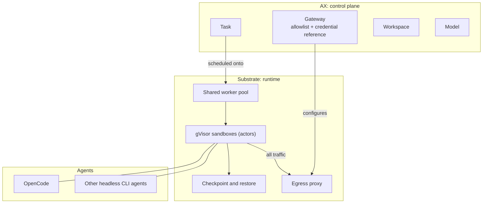
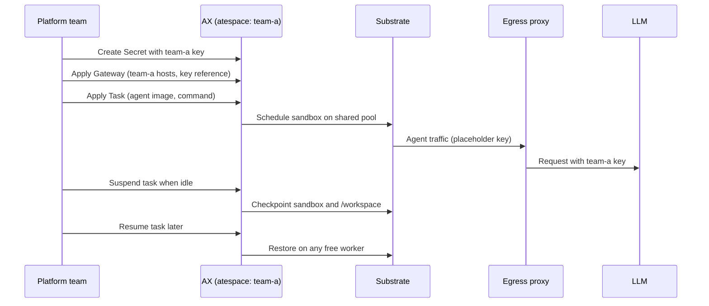

# Multi-agent and multi-tenant design

This page explains how Agent Substrate, AX and the coding agents combine to run many agents for many tenants on shared infrastructure.
It separates what this project has verified from what the design is meant to support.

## The goal

A platform team wants several teams (tenants) to run coding agents on one cluster.
The platform must:

- keep each tenant's credentials away from every agent and every other tenant,
- limit which hosts each tenant's agents can reach,
- use shared capacity well, even though agents sit idle while they wait on a model or a human,
- let agent work survive pauses.

## How the layers divide the work

| Concern                                      | Handled by                                                                                                             |
| -------------------------------------------- | ---------------------------------------------------------------------------------------------------------------------- |
| Who owns a task, gateway, workspace or model | AX scopes each by atespace. Commands accept `--atespace`.                                                              |
| Where a task runs                            | Substrate schedules sandboxes onto a shared worker pool.                                                               |
| Isolation between agents                     | One gVisor sandbox per task.                                                                                           |
| Credentials                                  | The Gateway references a Secret, and the egress proxy injects it. See [Credential injection](credential-injection.md). |
| Network policy                               | The Gateway's host allowlist, enforced by the egress proxy.                                                            |
| Idle capacity                                | `ax suspend task` checkpoints a task, and `ax resume task` restores it.                                                |
| Agent behavior and cost                      | The agent image, plus optional [token-saving tools](token-saving-findings.md).                                         |

## A tenant, end to end

Each tenant gets its own set of objects:

A second tenant repeats the same steps with its own atespace, Secret and Gateway.
Neither tenant's agents hold the other's key.

## What is verified

- A single task runs in a gVisor sandbox with a placeholder key, and the real key reaches the LLM.
- A host outside the Gateway allowlist is refused.
- `/workspace` persists across suspend and resume (a marker file written before suspend was present after resume).
- Both a mock and a real Anthropic-format gateway work with OpenCode.
- Two atespaces (`alpha`, `beta`) ran four tasks at the same time: three OpenCode agents and one shell agent.
  The mock LLM saw only `sk-tenant-alpha-KEY` and `sk-tenant-beta-KEY`.
- Each tenant cloned its own private repository through a Gateway that injects a git token.
  `beta` cloning `alpha/app` with its own token failed, so the credential policy holds.

See [Run the team demo](../how-to/run-team-demo.md) to repeat it.

## What is not yet verified

- How many agents fit on one worker. The test used one agent per worker pod.
- Whether restoring a checkpointed task on a different worker works for OpenCode.
  The resume worked, but the worker the task landed on was not recorded.
- Throughput and cost per agent under load.
- Tenant isolation against a hostile agent. The test checks credential and policy boundaries, not an attack.

## How tenancy is configured

Three settings make a tenant:

| Setting           | Where                                                           | Tenant `alpha`                                           |
| ----------------- | --------------------------------------------------------------- | -------------------------------------------------------- |
| Atespace          | `-a alpha` on every `ax` command                                | `alpha`                                                  |
| Secret            | A namespace per tenant, labeled `ax.io/credential=true`         | `tenant-alpha/llm-key`                                   |
| Credential policy | ConfigMap `ate-system/k8s-credential-provider-namespace-policy` | Atespace `alpha` may read only namespace `tenant-alpha`. |

The policy is the boundary.
The Gateway names a Secret as `ate-secret://k8s.io/default/<namespace>/<secret>/<key>`.
The credential provider refuses the lookup unless the calling actor's atespace is allowed that namespace.
That is why `beta-evil`, which referenced `tenant-alpha`, was denied.

## Related

- [Architecture](architecture.md)
- [Credential injection](credential-injection.md)
