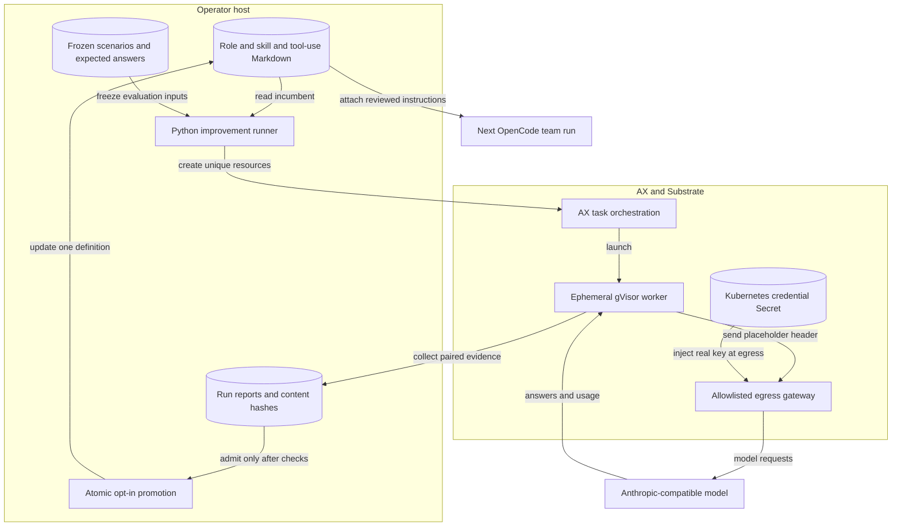

# Self-improvement: integration decisions and measured results

For the subsequent matched replay and full-team rerun, see
[the runtime-validation report](runtime-validation-report.md).
The reporting correction reproduced, but fresh-case accuracy tied and direct
token usage increased.

## What was reviewed

The [catalog](self-improvement-catalog.md) inventories **369 resource
occurrences / 337 unique titles** at upstream commit
`82b44515a3f34016c69c4737b55c4fd6bd87f521`. It assesses each entry's fit,
prerequisites, primary links and evidence depth, including duplicate/mislinked
entries. The [JSON twin](self-improvement-catalog.json) is searchable.

This is **not a full-text review of every paper**. Eleven primary abstracts were
retrieved; most entries were assessed at catalog/repository level. External
paper/video access was limited. Decisions with weak evidence remain preliminary.
See the catalog's per-entry evidence labels rather than assuming every linked
paper or tool was executed.

## Integration choices

| Mechanism                                    | Decision for AX/Substrate                                                                                                    |
| -------------------------------------------- | ---------------------------------------------------------------------------------------------------------------------------- |
| GEPA-style reflection and held-out selection | Adapt the bounded propose/evaluate/select mechanism; no Pareto search, merging, RL comparison or GEPA package integration    |
| ACE-style durable context deltas             | Append admitted clarifications to definitions; no separate Generator/Reflector/Curator agents                                |
| SkillOpt-style skill updates                 | Evaluate and atomically promote a skill artifact; do not import the upstream optimization runtime                            |
| Reflexion-style verbal feedback              | Feed training answers and exact correctness back to the proposer; not a reproduced Reflexion benchmark or action-retry agent |
| DSPy/MIPROv2, TextGrad, Trace                | Alternative optimizer stacks requiring different program/instrumentation interfaces; not added alongside the minimal loop    |
| ExpeL, Dynamic Cheatsheet                    | Potential future trajectory/memory curation; no autonomous Engram-memory promotion                                           |
| Agent-as-a-Judge                             | Deferred; use deterministic expected answers first, avoiding judge drift                                                     |
| SWE-bench/BFCL and related benchmarks        | Future workload gates; not substituted for the small local policy suites                                                     |
| Model-weight training                        | No training infrastructure in this POC; not implemented                                                                      |
| Self-modifying executable agents/tools       | Deferred pending independent evaluation and stronger admission controls                                                      |
| Domain-specific embodied/multimodal systems  | Not a drop-in fit for this coding-agent platform                                                                             |

**Upstream packages installed/integrated: zero.** The viable shared mechanisms
were implemented natively using Python's standard library and the platform's
existing model/gateway/sandbox interfaces. This avoids installing several
alternative frameworks for the same control loop. Full algorithms, proprietary
reproductions and integrations marked deferred are not claimed complete.

## Implemented system

### Application architecture

[Open the rendered architecture SVG](diagrams/self-improvement-architecture.svg).

<!-- mermaid-checked: no \n, no em-dash/en-dash, no {} in labels, subgraphs are id["label"], arrows use quoted labels, all subgraphs closed by end, ids unique -->



The host owns the source definitions and promotion.
The worker owns temporary evaluation state.
The gateway, not the worker, receives the real credential.
The model proposes instruction text but has no host editing capability.

| Layer           | Technology                     | Version or provenance                   | Responsibility                                        |
| --------------- | ------------------------------ | --------------------------------------- | ----------------------------------------------------- |
| Operator host   | Python standard library        | Python 3.10 or newer                    | Resource lifecycle, evidence collection and promotion |
| Orchestration   | AX                             | v0.4.0-rc.1                             | Task, Workspace and Gateway resources                 |
| Isolation       | Agent Substrate with gVisor    | Substrate v1.0.0                        | Sandbox execution and workspace persistence           |
| Model access    | Anthropic-compatible API       | Recorded model and image hashes per run | Proposal and scenario answers                         |
| Agent execution | OpenCode                       | Supplied digest-pinned image            | Runtime smoke and team tasks                          |
| Storage         | Markdown, JSON and JSONL files | Content hashes in run reports           | Definitions, snapshots and observations               |

No database or additional optimizer service is required.
Run folders are provenance records, not a signed append-only ledger.
The design separates model-generated text from credential policy and evaluator code.

### Evaluation and admission flow

[Open the rendered admission-flow SVG](diagrams/self-improvement-admission.svg).

```mermaid
flowchart LR
    subgraph EvaluationComponents["Evaluation components"]
        EvalInput["Definition and frozen suite"]
        EvalBaseline["Evaluate incumbent"]
        EvalReflect["Reflect on training observations only"]
        EvalAddition["Validate additive proposal and size"]
        EvalCandidate["Evaluate candidate on both splits"]
        EvalGate["Strict holdout gain and no paired loss"]
    end
    subgraph AdmissionComponents["Admission components"]
        EvalSmoke["Optional OpenCode file-writing check"]
        EvalReplace["Check source hash and replace atomically"]
        EvalKeep["Keep incumbent unchanged"]
        EvalReceipt[("Accepted and rejected evidence")]
    end

    EvalInput --> EvalBaseline
    EvalBaseline -->|"training feedback"| EvalReflect
    EvalReflect --> EvalAddition
    EvalAddition -->|"valid proposal"| EvalCandidate
    EvalAddition -->|"invalid or oversized"| EvalKeep
    EvalCandidate --> EvalGate
    EvalGate -->|"eligible"| EvalSmoke
    EvalGate -->|"regression or no gain"| EvalKeep
    EvalSmoke -->|"passed and opted in"| EvalReplace
    EvalSmoke -->|"failed or no opt-in"| EvalKeep
    EvalReplace --> EvalReceipt
    EvalKeep --> EvalReceipt
```

<!-- mermaid-checked: no \n, no em-dash/en-dash, no {} in labels, subgraphs are id["label"], arrows use quoted labels, all subgraphs closed by end, ids unique -->



Holdout answers are scored but never included in proposer messages.
A training gain cannot compensate for a holdout regression.
An unchanged score does not justify adding instruction text.

| Component                      | Type                                   | Responsibility                                               |
| ------------------------------ | -------------------------------------- | ------------------------------------------------------------ |
| Suite validation               | Input boundary                         | Check target paths, case IDs, splits and expected JSON       |
| Incumbent/candidate evaluation | Model adapter and deterministic grader | Record exact answers and provider usage                      |
| Reflection                     | Bounded model request                  | Propose an addition using training observations              |
| Admission gate                 | Deterministic decision                 | Require strict holdout gain with no paired loss              |
| OpenCode smoke                 | Optional runtime check                 | Verify one file-writing decision and unchanged inputs        |
| Promotion                      | Host-side file operation               | Refuse stale sources and atomically replace one definition   |
| Evidence collector             | File output                            | Preserve rejected proposals, token counts and cleanup status |

[The runner](../../scripts/12-self-improve.py) uses ephemeral AX resources,
the existing digest-pinned image and an Anthropic-compatible endpoint.
The credential remains in a Kubernetes Secret; egress injects it into the
worker's placeholder header. Generated text has no host execution capability.
The proposer cannot edit the suite, shared role boundaries or evaluator.
Reports retain rejected additions as well as accepted incumbents.

[The team demo](../../scripts/10-team-demo.sh) consumes promoted role definitions,
the evidence skill for every model-backed role, and the mutmut contract for
mutation only. A regression test verifies prompt assembly; script-only tasks
retain their existing execution path.

## Canonical experiments

Runs were collected on **2026-11-26 UTC** (2026-11-25 local time), using
`claude-sonnet-4-6` and image digest
`sha256:f60d41b313e50a94688f784bf85093957838f55a83dc6d0f37451738b8e9e993`.

Each suite contains three training and three holdout scenarios. Two repetitions
produce six training and six holdout answers per variant. These are **repeated
answers to six scenarios**, not twelve independent tasks.

| Target                   | Baseline train / holdout | Candidate train / holdout | Admission                                                     |
| ------------------------ | ------------------------ | ------------------------- | ------------------------------------------------------------- |
| Mutation role            | 4/6 / 6/6                | 6/6 / 4/6                 | Rejected: training gain hid a holdout regression              |
| Evidence skill           | 6/6 / 2/6                | 6/6 / 4/6                 | Promoted: holdout gain, no paired loss; OpenCode smoke passed |
| Mutmut tool-use contract | 6/6 / 6/6                | 6/6 / 6/6                 | Rejected: no improvement; extra text was unnecessary          |

The evidence skill's overall structured-answer accuracy changed from **8/12
(66.7%) to 10/12 (83.3%)**, a 16.7-percentage-point gain on this small suite.
The independent holdout change was **2/6 to 4/6**. This supports the bounded
admission decision; it is not a coding-success or token-saving result.

The mutation experiment demonstrates why aggregate-only selection is unsafe:
both variants scored 10/12 overall, while the candidate lost two previously
correct holdout answers. The gate preserved the original role.
The no-gain tool candidate was also rejected.

### Evidence and reproducibility

- [Mutation report](self-improvement-runs/mutation-agent-final-2026-11-26/report.json)
- [Evidence skill report](self-improvement-runs/evidence-skill-smoke-absolute-2026-11-26/report.json)
- [Tool contract report](self-improvement-runs/mutmut-tool-final-2026-11-26/report.json)
- [All-run results and token totals](self-improvement-results-2026-11-26.json)
- [Run procedure and constraints](../how-to/self-improve-agent-definitions.md)

Each canonical experiment issued 25 direct model requests; **75 requests**
used **37,923 input tokens and 1,914 output tokens**, with no reported cache
read/creation tokens. No monetary cost is inferred without provider pricing.

Including development/protocol-fix experiments, the collected receipts total
**316 direct requests, 137,847 input tokens and 9,658 output tokens**.
OpenCode's smoke usage was not separately measured and is excluded from those
totals. These are optimization costs, not savings.

### Runtime and persistence verification

The promoted evidence definition was supplied as an actual OpenCode attachment
inside the AX sandbox. OpenCode wrote:

```json
{ "claim_verified": false, "classification": "unverified" }
```

for the recovered-versus-unattended-run scenario. The external worker evaluator
verified exit zero, exact JSON and unchanged input files.
This verifies one file-editing decision task, not the whole team workflow.

The final promoted file's SHA-256 matches the admitted candidate in its report.
All final run-owned Tasks, Workspaces, Gateways and Secrets were removed.
Existing resources were preserved and worker replicas were not changed.
Eleven unit/regression tests passed, shell syntax passed, and the Git whitespace
check passed.

## Failed attempts and fixes

Failures are retained in the [all-run summary](self-improvement-results-2026-11-26.json),
not hidden as successful runs:

1. The initial encoded Task configuration was 53,918 bytes, above AX's 31,744-byte
   limit. Compressing the launch bundle with stdlib `zlib` fixed admission.
2. A cleanup diagnostic bytes/text mismatch interrupted the first retry's
   deletion sequence. It was fixed; the exact leftover resource names were
   subsequently deleted. Final checks found no run-owned resources.
3. The proposer sometimes emitted reasoning/Markdown instead of JSON.
   A dedicated raw-JSON system contract fixed the protocol. Evaluator answers
   still require raw JSON; scoring was not relaxed to accept fenced answers.
4. An initial conservative gate required gains on both splits, rejecting a
   holdout improvement when training was already perfect. The final gate
   requires strict holdout gain and no paired regression anywhere. This is a
   gate-design change, not a change to expected answers; earlier runs are
   retained and should not be pooled with final-protocol accuracy.
5. OpenCode did not resolve relative attachments. Absolute attachment paths
   fixed the smoke. The failing smoke attempts refused promotion.
6. An earlier Unicode-punctuation skill promotion was superseded by a new run
   that normalized punctuation **before** evaluation, then passed the runtime
   smoke and promoted the evaluated ASCII candidate.

## Limits and next gates

- The remaining evidence-skill holdout case `interrupted-score` still fails on
  both repetitions: the model calls a verified partial-progress claim
  `verified` rather than the expected `partial`. This also exposes a taxonomy
  nuance worth independent gold-answer review. The score is not perfect, and
  the expected answer was not weakened.
- These cases were authored from an earlier real team run, but the improvement
  evaluations are structured policy decisions, **not reruns of that coding epic**.
- The same model proposes and answers. A deterministic grader avoids LLM-judge
  drift, but it cannot establish robust generalization from this sample.
- Evaluation is incumbent-first, candidate-second. Case order is reversed on
  alternate repetitions; variant order is not randomized. Repetition at
  temperature zero is not statistical independence.
- Holdout answers are withheld from proposer messages. Repeated human-visible
  experiments still make this a development holdout, not a forever-blind test.
- Additive-only updates preserve text, not semantic safety against every
  contradictory instruction. Require review and stronger workload-specific
  safety cases before production admission.
- No signed append-only ledger, automatic PR approval, automatic schedule,
  executable-tool evolution or upstream package benchmark reproduction exists.
- Future end-to-end admission needs frozen coding tasks, real test/mutation
  results, ownership/isolation checks, a fresh blind evaluation set and explicit
  spend/latency limits. Do not infer those gains from this report.
