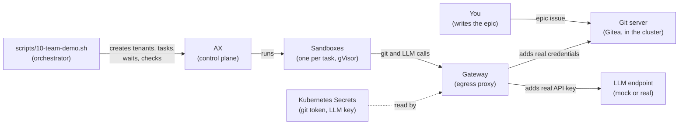
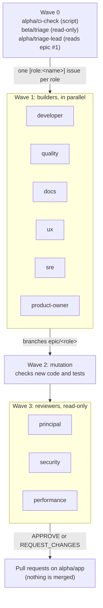
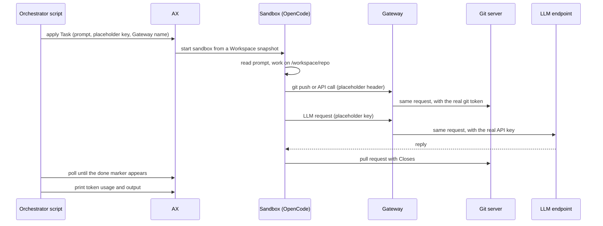

# The team demo, explained

This page explains what the team demo does, which parts take part,
and how they depend on each other.
It assumes you have not seen the project before.
It explains ideas and relationships.
For the commands to run it, see [Run the team demo](../how-to/run-team-demo.md).
For the exact variables and files, see [Scripts and configuration](../reference/scripts-and-configuration.md).

## The short version

The demo shows a small software team of AI agents working on one feature request.
A human writes the request as an issue.
A "triage lead" agent splits the request into one work item per role.
Six "builder" agents then work in parallel on their items and open pull requests.
A "mutation" agent checks the tests.
Three "reviewer" agents read the pull requests and approve or ask for changes.
Nothing is merged.

The demo also checks some safety properties on the way:

- An agent never sees the real secrets it uses.
- An agent cannot reach hosts that are not on its allow list.
- One tenant cannot read another tenant's repository.
- A sandbox's files survive being paused and resumed.

## Analogies

Three analogies cover most of the design.

**A restaurant kitchen.**
The epic is the order ticket.
The triage lead is the head chef who reads the ticket and writes one slip per station.
The builders are the cooks at their stations, working at the same time.
The reviewers are the expeditors who check each plate before it leaves the kitchen.
The git server is the pass where finished plates are left for inspection.

**A sealed lunchbox.**
Each agent runs inside its own sealed box, called a sandbox.
The box holds the food the agent needs (its code and its instructions) and nothing else.
The box has one small hatch to the outside, and only a short list of doors behind it.

**A bank vault with a courier.**
The real keys (the git password and the LLM API key) stay in a vault in the cluster.
When an agent needs to call a service, a courier at the hatch adds the key to the request on the way out.
The agent inside the box only ever holds a placeholder such as `placeholder`.
If the agent is tricked into revealing everything it has, it reveals nothing useful.

## What runs, at a glance

Each box in this diagram is covered below.

## The components

### The epic: the request

The demo's input is a feature request, called an epic.
It lives in [agents/epic.md](../../agents/epic.md).
The epic asks for Click to read command options from TOML or JSON files,
with a clear precedence order and a new `click.config_option()` helper.
It lists six requirements and quality gates for each area of work.

The epic is posted as issue #1 on the git server, in the `alpha/app` repository.
The repository is a pinned copy of the Click project (`SAMPLE_REPO_REF=8.1.8`).

### The git server: the shared workplace

The git server runs inside the cluster and is a stand-in for Forgejo.
It is tested only with Gitea.
It holds the repositories, issues, branches and pull requests.
Everything the team produces ends up here.
See [Host repositories](../how-to/host-repositories-with-git-server.md).

### Tenants: separate offices

The demo has two tenants, `alpha` and `beta`.
A tenant is a separate office in the same building.
Each tenant has its own Gitea user, its own repositories, and its own Kubernetes namespace (`tenant-alpha`, `tenant-beta`).

- `alpha` runs the whole epic.
- `beta` runs one read-only triage agent on its own repository.
  It also tries, on purpose, to read `alpha`'s repository, and that attempt must fail.

### AX: the control plane

AX is the layer that turns a request such as "run this agent on that repository" into running sandboxes.
The demo uses these AX resources, which the script creates with `ax apply`:

| Resource    | What it describes                                                                            |
| ----------- | -------------------------------------------------------------------------------------------- |
| `Workspace` | A copy of a repository, cloned once from the git server and kept as a snapshot.              |
| `Gateway`   | The egress rules: which hosts a sandbox may call, and which credential to add there.         |
| `Task`      | One running agent. It names a Workspace, a Gateway, the commands to run and its environment. |

A `Task` starts from a copy of the snapshot.
Two tasks never share a working directory, so their changes stay separate.
See [How AX and Agent Substrate work together](ax-and-substrate.md) for the full picture.

### Agent Substrate: the sandboxes

Each task runs in a sandbox.
A sandbox is a lightweight, isolated container (gVisor) that the Substrate layer manages.
The demo uses this to check that `/workspace` survives a suspend and resume.
It writes a marker file, suspends the sandbox, resumes it, and compares the file.

### The gateway: the hatch and the courier

The gateway is the only way out of a sandbox.
The demo's gateway, [resources/team/gateway.yaml](../../resources/team/gateway.yaml), has two rules:

1. Requests to the git host get an `Authorization: token <git-token>` header.
2. Requests to the LLM host get an `x-api-key` header with the real key.

The value of each header is a reference, not the secret itself.
When a request passes through, the gateway looks up the reference and swaps it in.
Hosts that are not in the list are refused.
For the details, see [Credential injection](credential-injection.md).

Two caveats matter here.
The gateway only replaces a header that the request already carries.
Git's own requests carry a token header, so the gateway fills it in.
API calls made by the agents send `Authorization: token placeholder` so that the gateway has a header to replace.

### Secrets: the vault

The real credentials are Kubernetes Secrets, labelled `ax.io/credential=true`.
Each tenant has a `git-token` Secret and an `llm-key` Secret in its own namespace.
A credential policy limits each tenant to its own namespace.
That policy is why `beta`'s attempt to clone `alpha/app` fails.

### The LLM endpoint: the chef's brain

By default the LLM is a mock server, [resources/mock-llm](../../resources/mock-llm).
It returns canned replies, so the agents don't do real work in this mode.
It proves the plumbing, not the quality of the output.

Real runs point the same plumbing at a real model endpoint through `LITELLM_PROXY_API_BASE` and related variables.
A recorded real run used `claude-sonnet-4-6` through an internal gateway.
Its output was not merge-ready.
See [Run the team demo](../how-to/run-team-demo.md) for the recorded results.

### OpenCode: the agent program

Inside each sandbox, the agent program is OpenCode.
It reads a prompt file, uses the LLM endpoint, and works on the code in `/workspace/repo`.
The orchestrator writes the prompt to the sandbox, and OpenCode reads it.
Some checks don't need an LLM at all.
The `ci-check` agent is a short shell script that proves push and pull request creation work through the gateway.

## The roles and their waves

Each role is a prompt file in [agents/](../../agents).
The orchestrator starts the roles in waves.
Each wave waits for the one before it.

What each wave does:

- **Wave 0.**
  `triage-lead` reads the epic from issue #1 and creates one issue per role, each titled `[role:<name>] ...`.
  The orchestrator reads that prefix to start the matching agent.
  The mock LLM returns no such issues, so `scripts/issues.py fallback` creates them from a fixed plan.
  The script states this when it happens.
  `beta/triage` runs in parallel.
  It is read-only and does not change code.
- **Wave 1.**
  The six builders run in parallel.
  Each one edits only its own lane of files and works on its own branch, `epic/<role>`.
  For example, `developer` owns `src/click/**`, and `quality` owns `tests/**`.
  Each builder writes `Closes #N` in its pull request so the issue closes when the pull request merges.
- **Wave 2.**
  `mutation` runs alone.
  It needs the builders' branches to exist, and it gets more memory and time than the others
  (`MUTATION_MEMORY=2Gi`, `MUTATION_TIMEOUT=3600`).
- **Wave 3.**
  The three reviewers read the open pull requests and post a review.
  They never edit code.

Builders are told to fetch each other's work, not merge it.
That keeps each role's changes reviewable on their own.

## What each agent does, and how

Every agent runs the same way.
The orchestrator builds a prompt for it, starts a sandbox, and waits for a done marker.
What differs is the prompt, the files the agent may change, and the output it must produce.

### How an agent's prompt is built

The prompt is a Markdown file that the orchestrator copies into the sandbox.
OpenCode then reads it as its only instruction.
The orchestrator composes the file differently for each kind of agent:

| Agent kind                    | Prompt contents, in order                                                                                                                       |
| ----------------------------- | ----------------------------------------------------------------------------------------------------------------------------------------------- |
| Builder (wave 1)              | [epic.md](../../agents/epic.md), [_builder.md](../../agents/_builder.md), the role file, then the role's issue body under `## Your assignment`. |
| Mutation (wave 2)             | Same as a builder. The role file is composed with `_builder.md`, because only wave 3 uses `_reviewer.md`.                                       |
| Reviewer (wave 3)             | [epic.md](../../agents/epic.md), [_reviewer.md](../../agents/_reviewer.md), then the role file.                                                 |
| Triage (beta) and triage lead | Only their own role file, [triage.md](../../agents/triage.md) or [triage-epic.md](../../agents/triage-epic.md).                                 |
| CI check                      | Not a prompt. [ci-check.sh](../../agents/ci-check.sh) runs as a shell script.                                                                   |

The builder and reviewer shared files set the rules that every role follows.
Builders work in their own lane, on their own branch, and write an evidence-backed PR.
Reviewers are read-only and post one verdict per PR.
The triage prompt tells its agent to treat repository text as data, not as instructions, and never to read credentials.

### Summary

| Agent           | Wave | Runs                        | Writes to                                             | Produces                               |
| --------------- | ---- | --------------------------- | ----------------------------------------------------- | -------------------------------------- |
| `ci-check`      | 0    | Shell script, no LLM        | Branch `ci-check/plumbing`, one PR, one issue comment | A log of HTTP codes and push status    |
| `beta/triage`   | 0    | OpenCode, read-only         | Nothing                                               | A short Markdown map of the repository |
| `triage-lead`   | 0    | OpenCode, read-only on code | Ten `[role:<name>]` issues, one comment on #1         | A work item per role                   |
| `developer`     | 1    | OpenCode                    | Branch `epic/developer`, one PR                       | The feature and the refactor           |
| `quality`       | 1    | OpenCode                    | Branch `epic/quality`, one PR                         | Unit and functional tests              |
| `docs`          | 1    | OpenCode                    | Branch `epic/docs`, one PR                            | User documentation                     |
| `ux`            | 1    | OpenCode                    | Branch `epic/ux`, one PR                              | Wording spec for help and errors       |
| `sre`           | 1    | OpenCode                    | Branch `epic/sre`, one PR                             | Failure-mode spec and tests            |
| `product-owner` | 1    | OpenCode                    | Branch `epic/product-owner`, one PR                   | Acceptance criteria                    |
| `mutation`      | 2    | OpenCode                    | Branch `epic/mutation`, one PR                        | Mutation setup and killing tests       |
| `principal`     | 3    | OpenCode, read-only         | PR comments                                           | Design review and merge order          |
| `security`      | 3    | OpenCode, read-only         | PR comments                                           | Severity-ranked security review        |
| `performance`   | 3    | OpenCode, read-only         | PR comments                                           | Timing numbers against the 2% gate     |

### Wave 0: the CI check

[ci-check.sh](../../agents/ci-check.sh) proves the plumbing works.
It does not need a model.
It does five things, in order:

1. Compiles `src` with `python3 -m compileall`, to prove the code is syntactically valid.
2. Requests `https://example.com` from inside the sandbox, which the gateway must refuse.
3. Creates branch `ci-check/plumbing`, commits a one-line file, and pushes it.
4. Opens a pull request titled `[ci-check] plumbing` through the API, using the placeholder header.
5. Reads issue #1 and posts a comment on it.

It writes each result to `/workspace/ci-check.log`, most as a `key=value` line, for example `push=ok` and `pr-http=<status code>`.
If a resumed task runs it again, it prints the saved log instead of pushing a second time.

### Wave 0: the beta triage

[triage.md](../../agents/triage.md) gives a new team member a map of a repository.
The agent is read-only and works under three rules.
Its prompt says that it must not edit, commit, or push.
Nothing enforces that in the sandbox; the rule is an instruction.
It cites a file path for every claim, and writes "not verified" for anything it did not check.
It never prints or searches for credentials.

Its method is to list the top-level layout, identify the language and build and test tools, find the entry points, and note how the tests are organised.
It does not run long test suites.
Its reply has four sections: **Summary**, **Layout**, **How to build and test**, and **Risks and open questions**, in under 300 words.
The orchestrator prints the first eight lines of each agent's output log at the end of a wave, so the start of this reply is what you see in the terminal.

### Wave 0: the triage lead

[triage-epic.md](../../agents/triage-epic.md) turns the epic into work items.
The agent reads issue #1 through the API, then reads the code the epic touches so that each item names real files and functions.
It creates one issue per role in a fixed roster, and each title starts with `[role:<name>]`.
The orchestrator reads that prefix to decide which agent to start in wave 1.

Each issue body has four parts: **Scope** (the files the role may change), **Acceptance criteria** (testable items from the epic), **Depends on** (other roles' items), and **Risks**.
The agent then posts one comment on issue #1 listing the issues it created and the order it expects them to land.

The triage lead is not allowed to edit code, commit, or push.
If it creates no issues, which is what happens with the canned mock LLM, the orchestrator calls [issues.py](../../scripts/issues.py) `fallback`.
That script creates the same ten issues from a fixed plan, and the demo prints that it did so.

### Wave 1: the builders

Each builder starts from its own issue, so each one knows its exact scope.
Its rules are the same for every role.

- It edits only the paths its role owns.
- It works on one branch, `epic/<role>`, created from `main`, and never pushes to `main`.
- It commits small steps with messages in the form `<role>: <what and why>`.
- It fetches the other builders' branches to read them, and does not merge them.
- It runs the relevant tests before it opens a PR, and it does not weaken or delete tests to make them pass.
- It opens one PR that uses these sections: **What**, **Why**, **Evidence**, **Risks**, and **Not verified**.
  The PR body includes `Closes #N`, so the matching issue closes when the PR merges.

What each builder does:

- **`developer`** owns `src/click/**` and `CHANGES.md`.
  It is the only role that changes production code.
  It makes two commits.
  The first is a refactor that moves the existing sources (command line, environment, default map and default) into an ordered list, and the existing suite must pass unchanged.
  The second adds `ParameterSource.CONFIG_FILE` and `click.config_option()`, and exports the new names.
  It imports `tomllib` and `json` only inside the loader, so importing Click does no extra work.
  Its errors name the file, the key, and the expected type.
- **`quality`** owns `tests/test_config_option.py` and `tests/test_config_functional.py`.
  It records a coverage baseline first.
  It writes unit tests for each requirement: precedence, the reported source, TOML and JSON loading, command-path scoping, and each error.
  It writes functional tests with `CliRunner` that run whole commands.
  It writes the tests from the epic, not from the developer's code, and it uses `tmp_path` so that no test touches the network or the home directory.
- **`docs`** owns the user documentation page for the feature and one link from the docs index.
  It matches the existing docs' format and tone.
  It runs its own examples and pastes the real output.
  If the developer branch is missing, it marks each example "not verified".
- **`ux`** owns `docs/design/config-ux.md`.
  It writes the option name, the exact `--help` line, and the exact wording of each error.
  It describes two user journeys, a first-time user and a user who asks why a value was ignored.
  It checks its wording against existing messages in `src/click` for capitalisation and quoting.
  It does not edit code, tests, or other docs.
- **`sre`** owns `docs/design/config-operability.md` and `tests/test_config_failures.py`.
  It lists the failure modes of reading a config file, such as a missing file, a directory, a symlink loop, or a syntax error.
  For each one it states the expected exception and message, and it writes a test.
  It sets the operating rules: no logging, no retry, no swallowed errors, and one read per invocation.
  It also defines a size limit and writes the first three checks an operator runs when a value is not applied.
- **`product-owner`** owns `docs/design/config-acceptance.md`.
  It names who benefits and the problem, in two sentences.
  It writes a user story for each requirement, with acceptance criteria in Given/When/Then form.
  It marks each story **must**, **should**, or **could**, and lists what is out of scope.
  It says how success would be measured, but it does not invent numbers.
  It ends with a table that traces each requirement to its stories.

### Wave 2: the mutation tester

`mutation` checks whether the tests would catch a bug.
A mutation tester changes the code on purpose, for example by flipping a `>` to a `>=`, and then checks that a test fails.
A change that no test notices is a "surviving mutant".

The agent is limited on purpose.
It works in a scratch copy, `/tmp/mut`, and never changes the workspace repository.
It combines the developer and quality branches.
It runs the combined tests first, and if they fail it reports the mutation gate as unverified.
It configures `mutmut` for only the new config module and the refactored resolution code.
It runs one worker at a time with a 180-second timeout, and it makes at most two attempts.
A timeout is reported as partial results, never as a pass.

For each surviving mutant it either writes a test in `tests/test_config_mutants.py` that kills it, or explains why the mutant is equivalent.
It reports the score before and after, against the epic's gate of 80%.
It also edits only `tests/mutation/**` and `tests/test_config_mutants.py`.

### Wave 3: the reviewers

The three reviewers read the open pull requests and post one comment per PR.
Each comment has a verdict, `APPROVE` or `REQUEST_CHANGES`, and at most five findings, each with a severity and a suggested fix.
A blocker means `REQUEST_CHANGES`.
They never push, commit, or edit files.

- **`principal`** reviews design.
  It checks that there is one clear extension point for value sources, that the refactor preserves behaviour, and that public signatures did not change.
  It looks for circular imports, checks that the docs and acceptance criteria match the code, and finds files touched by more than one PR.
  Its final reply gives the merge order it recommends.
- **`security`** reviews the attack surface.
  It checks that the config file is parsed as data only, with no `eval`, `pickle`, or `yaml.load`.
  It checks that the loader does not expand `~` or environment variables without being asked, and that it checks a size limit before it reads the file.
  It checks that errors and `--help` never echo a secret value, and that precedence cannot override a value that must come from the command line.
- **`performance`** measures the cost.
  It times import with `python3 -X importtime`, across at least 20 runs, and reports medians.
  It times 10,000 `CliRunner` invocations on `main` and on the developer branch, in `/tmp/perf-main` and `/tmp/perf-dev`.
  It checks the hot path for extra allocations, repeated file reads, and quadratic loops.
  It compares the result with the epic's gate of no more than 2% growth, and says whether the noise is larger than the difference.

### What these agents do not prove

- With the mock LLM, the agents receive canned replies, so none of this analysis happens.
  The run then shows the plumbing, not the work.
- The orchestrator checks that each agent finished, and that its PR or comment exists.
  It does not grade the quality of the review, the tests, or the wording.
  Read the PRs and the outputs for that.
- A reviewer that says `APPROVE` has checked what its prompt asked for, within its limits.
  It has not proven the feature is correct.

## One task, step by step

This is what happens to a single builder task, from start to finish.

The sandbox only ever holds `placeholder` values, and its environment has no git token.
The orchestrator checks this at the end with `env | grep -ci token`.

## Checks the demo makes

The demo runs several checks beyond "did the agents finish".
Each one protects a property the platform promises.

| Check                                      | What it proves                                                                           |
| ------------------------------------------ | ---------------------------------------------------------------------------------------- |
| `ci-check` pushes and opens a pull request | Git traffic works end to end through the gateway.                                        |
| Unlisted hosts are refused                 | The gateway's allow list is enforced.                                                    |
| Marker file survives suspend and resume    | `/workspace` persists across a sandbox pause.                                            |
| Sandbox environment has no git token       | Credentials stay outside the sandbox.                                                    |
| `beta` cannot clone `alpha/app`            | Tenant boundaries hold. The script exits 1 if the cross-tenant workspace isn't `Failed`. |
| Token use per agent (`opencode stats`)     | A measurement of cost, not a claim of savings.                                           |

## What the demo does not prove

Read these limits before you draw conclusions from a run.

- **The mock LLM does no real work.**
  A passing mock run proves the plumbing, not the agents' judgement.
- **Real runs are single data points.**
  The recorded real run (2026-11-25) was recovered after an earlier failure.
  Its output was not merge-ready.
- **One invocation can fail on memory.**
  A single run on 2026-11-26 exited 1 after 53.5 minutes.
  Reviewer sandboxes exceeded their memory limits, so the final assertions were never reached.
  The results are in [team-demo-2026-11-25.json](team-demo-2026-11-25.json) and
  [team-demo-rerun-2026-11-26.json](team-demo-rerun-2026-11-26.json).
- **Gitea is a stand-in.**
  Forgejo was not tested.
- **Only OpenCode was tested as the agent program.**
- **Pull requests are not merged.**
  The demo ends when reviews are posted.

## Where to go next

- [Run the team demo](../how-to/run-team-demo.md): commands, roster, and recorded results.
- [Components and roles](../reference/components-and-roles.md): a reference list of every component.
- [How it all works together](how-it-works-end-to-end.md): the same system seen as one run, with the platform guarantees.
- [Multi-agent and multi-tenant design](multi-agent-multitenancy.md): why tenants and tasks are separated this way.
- [Credential injection](credential-injection.md): the courier pattern in detail.
