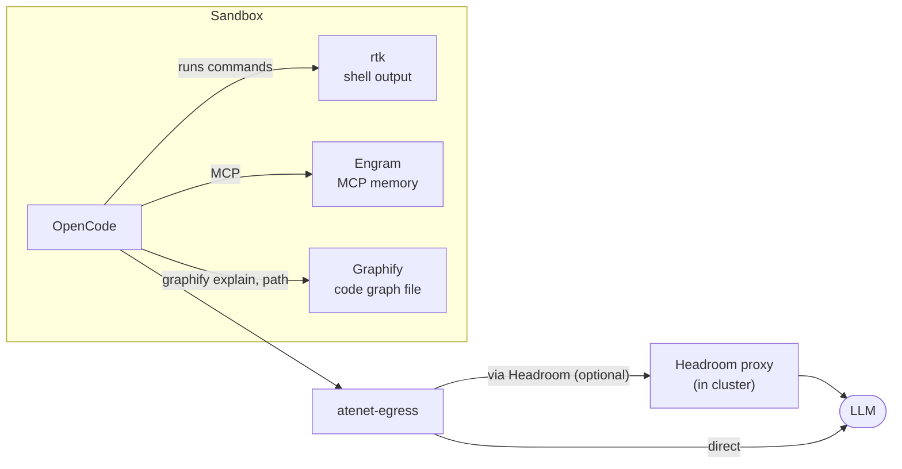

# Token-saving findings

This page records what four token-saving tools did in this project,
and what the results do and do not show.
To turn a tool on, see [Enable token-saving tools](../how-to/enable-token-saving-tools.md).

## Method

The dated benchmark below uses paired requests from one AX sandbox through a real Anthropic-format gateway.
It measures the context sent after command-output or request compression, using provider-reported usage.
The older full-agent experiments use `opencode stats`, summing input, cache read, cache write and output tokens.
Those historical results are single runs, not directly comparable to the bounded benchmark.
LLM output and savings vary with workload.

## Paired benchmark: 2026-11-25

The [benchmark script](../../scripts/11-token-benchmark.py) completed **18 requests, all with correct answers**:
three baseline/tool pairs for each of three workloads.
The model was `claude-sonnet-4-6`, with rtk `1.2.1`, pytest `9.2.0`,
and Headroom `0.45.0` in `token` mode on `aarch64`.
The [raw results](token-saving-benchmark-2026-11-25.json) record every request,
the image digest, output sizes, expected fixture exit codes, and answer checks.

| Workload                                | Baseline input tokens | Tool input tokens | Input tokens saved | Input saving | Total tokens, baseline/tool |
| --------------------------------------- | --------------------- | ----------------- | ------------------ | ------------ | --------------------------- |
| `git log -10 --stat`, plain versus rtk  | 1,172                 | 1,172             | 0                  | 0.0%         | 1,177 / 1,177               |
| Verbose pytest output, plain versus rtk | 2,149                 | 146               | 2,003              | **93.2%**    | 2,161 / 158                 |
| JSON history, direct versus Headroom    | 3,440                 | 1,052             | 2,388              | **69.4%**    | 3,445 / 1,057               |

Values are medians across three requests per variant; token counts were identical within each variant.
Total tokens include output; total-token savings were 92.7% for pytest and 69.3% for JSON history.
Both cache-read and cache-write usage were zero on every request.
These are context-compression savings, not cache discounts or dollar-cost estimates.

### Workloads and checks

- **Git log:** both commands explicitly request ten commits from the image's 120-commit demo repository.
  Both outputs were 2,575 bytes and every answer correctly counted ten commits.
  There was no compression benefit for this command/flag combination.
- **Pytest:** a generated fixture contains 80 passing tests and two deliberately failing tests.
  Both commands exited 1 as expected; this is fixture data, not a failed benchmark.
  rtk reduced output from 7,526 to 296 bytes.
  Every answer correctly reported 80 passed and two failed.
  The check verifies those counts, not whether all failure diagnostics survive compression.
- **Headroom:** the same conversation contains 100 synthetic health-check records in an earlier assistant message.
  Every answer correctly counted 100 records after either direct or compressed delivery.
  This does not establish fidelity for arbitrary JSON fields or other question types.

The script alternates baseline/tool request order, uses temperature 0 and a 128-output-token limit,
and generates command outputs once before repeating the requests.
It sends these outputs directly to the Messages API from inside the sandbox;
it does **not** run an OpenCode agent loop or include MCP/tool-definition overhead.
No combined percentage is claimed across different workloads or tools.
Engram and Graphify were not remeasured.
The earlier full-team runs were incomplete because their mutation sandbox exceeded its memory limit.
The recovered runtime check below also does not establish whole-team savings.

### Reproduce

Configure `.env.opencode` with the compatible image and working LiteLLM credentials,
following [Use a real LLM endpoint](../how-to/use-real-llm-endpoint.md).
The image must include Python, pytest, rtk, and `/opt/demo-repo`.
The cluster and credential-injection policy must already be configured.
For Headroom, deploy it against the same upstream and enable token mode first:

```bash
kubectl -n default set env deploy/headroom HEADROOM_MODE=token
kubectl -n default rollout status deploy/headroom --timeout=120s
python3 scripts/11-token-benchmark.py --repetitions 3 --headroom \
  --output /tmp/token-benchmark.json
```

Omit `--headroom` to measure only rtk.
The benchmark uses one worker without scaling the pool, isolates its resource names,
and removes its task, workspace, Gateway, and API-key Secret on exit.
It loads local credentials without printing them; the task receives a placeholder,
and the Gateway injects the real API key.
Headroom still sees that key when used.
The JSON results contain no credentials or user-header values.

## Full-team runtime check: 2026-11-25

After increasing only mutation's memory budget and running it after the other builders,
all 13 distinct role commands completed across a recovered staged run, including the three reviewers.
The [raw run summary](team-demo-2026-11-25.json) preserves usage by role and the cancelled mutation attempt.
The initial orchestrator timed out (exit 1); a targeted retry and reviewer/final-check continuation
completed (exit 0). This is not a verified clean unattended run.

| OpenCode usage counter          | Approximate tokens, including the cancelled attempt |
| ------------------------------- | --------------------------------------------------- |
| Uncached input                  | 761                                                 |
| Output                          | 243.2K                                              |
| Cache read                      | 47.6M                                               |
| Cache write                     | 696.8K                                              |
| Total, including cache counters | 48.5M                                               |

These are sums of rounded `opencode stats` displays, not an exact provider ledger or a bill.
The cancelled mutation attempt alone reported 16.9M cache-read tokens and 47.6K output tokens;
excluding it would hide substantial retry overhead.
There is no matched full-team baseline, so **no whole-team or monetary savings are claimed**.
The paired compression results above remain unchanged.

Runtime completion did not establish feature correctness: the reviewers requested changes,
the mutation agent reported 39 failing combined-baseline tests, and the mutation score remained
unverified because of a Click/mutmut import conflict.
Prompt instructions limiting diagnostics were advisory and did not reliably bound tool attempts.
See the [team run details](../how-to/run-team-demo.md#real-provider-recovered-run-2026-11-25)
for the recovery path, successful isolation/persistence checks and remaining quality limitations.

## Where each tool sits



rtk, Engram and Graphify run inside the sandbox and shrink what the agent reads or re-discovers.
Headroom runs outside it and shrinks the request in transit.

## Summary

| Tool     | What it does                   | Works in the sandbox | Measured effect                                                                            |
| -------- | ------------------------------ | -------------------- | ------------------------------------------------------------------------------------------ |
| rtk      | Compresses shell output        | Yes                  | 93.2% fewer input tokens on verbose pytest; no saving on `git log -10 --stat`              |
| Headroom | Compresses requests in a proxy | Yes                  | 69.4% fewer input tokens on synthetic JSON history; older plain-text test saved about 2.5% |
| Engram   | Persistent memory over MCP     | Yes                  | Recall across sessions works; adds about 27 tool definitions                               |
| Graphify | Code graph for navigation      | Yes                  | About 28% fewer tokens and 58% fewer tool calls                                            |

## rtk

In an older full-agent experiment on a demo repository, the prompt asked the agent to run `git log --stat` and count commits for a file.

| Run         | Tokens    | Answer  |
| ----------- | --------- | ------- |
| Without rtk | about 38K | Correct |
| With rtk    | about 43K | Correct |

`rtk git log --stat` cut the output from 30 KB to 2.5 KB but showed only 10 commits.
The agent then reran plain `git log --stat`, so it paid for both.
The dated paired benchmark above confirms a benefit on verbose pytest output.
`git status` and full-agent pytest savings remain untested.

## Headroom

In the older plain-text experiment, the request path worked and the answer was correct.
Savings were small because the large input was plain-text `git log` output,
which Headroom's router left alone.
Token mode and cache mode gave the same result.
Headroom targets repeated JSON, logs and large files.
The dated benchmark above measures one such synthetic JSON workload.
It also sees the real API key.

## Engram

In one task, session 1 saved a fact with `engram_mem_save`.
Session 2, started separately in the same task, recalled it with `engram_mem_search`.
A session used about 33K tokens, partly because Engram adds 27 tool definitions to each request.
Memory across different tasks needs a shared store that this project does not set up.
Persistence across suspend and resume was not tested.

## Graphify

The question was a cross-file lookup on `pallets/click`: classes that inherit from `Command`,
and callers of `Context.invoke`.
The graph held 3.5K nodes and 6.8K edges.

| Run      | Tool calls | Output tokens | Total tokens |
| -------- | ---------- | ------------- | ------------ |
| Baseline | 19         | 2.8K          | about 72K    |
| Graphify | 8          | 0.9K          | about 52K    |

Accuracy did not clearly improve.
The graphify run listed only 2 of the direct `Command` subclasses.
Treat the graph as a navigation aid and verify answers.

## Answer accuracy: 2026-11-26

`scripts/13-accuracy-eval.py` asks four fixed questions over fixed inputs and scores each answer against ground truth.
The baseline sends raw output, and the rtk variant sends output filtered by rtk.

| Variant  | Accuracy (3 repeats) | Mean input tokens | Mean total tokens |
| -------- | -------------------- | ----------------- | ----------------- |
| baseline | 12/12                | 6,812             | 6,907             |
| rtk      | 9/12                 | 3,266             | 3,298             |

rtk cut input tokens by about 52%, but lost accuracy on one case.
On `git log --stat` author counting, rtk's compressed output led the model to answer `3` instead of `40`.
The pytest, error-code, and untracked-file cases matched the baseline.
The sample is small, so treat this as a signal to verify, not a measured rate.

The team demo run (`ACCURACY_REPETITIONS=1`) ended with rtk at 3/4 and baseline at 4/4 on the same cases, with the same `git log` miss.

### Cost tools compared

| Source                  | Sees benchmark and harness calls | Measures accuracy | Output                                     |
| ----------------------- | -------------------------------- | ----------------- | ------------------------------------------ |
| `11-token-benchmark.py` | Yes                              | No                | Paired token counts per workload           |
| `13-accuracy-eval.py`   | Yes                              | Yes               | Pass rate per variant and case             |
| `codeburn`              | No (local agent logs only)       | No                | Spend by model and task, Copilot providers |
| `ccusage`               | No (local agent logs only)       | No                | Daily tokens and cost by model             |

On this machine, `codeburn` reported about $10.5 spend for the month across 11,000 calls, and `ccusage` listed Sonnet, Opus, and Haiku by day.
Neither tool shows the benchmark or harness calls, and `ccusage opencode` had no data.
Use them for ongoing cost by model and task, not for comparing token-saving variants.

## What is still open

- Repeat full-agent tests several times to measure variance.
- Expand the paired pytest/JSON benchmarks to varied real workloads and richer accuracy checks.
- Test Engram across suspend and resume, and across tasks.
- Find out why rtk drops per-commit detail from `git log --stat`, and whether a rtk option keeps it.
