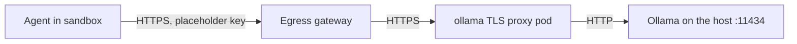

# Run the team demo with Ollama

Run the epic demo against a model served by Ollama on your own machine.
No API key or external gateway is needed.

## Before you begin

- The cluster, image, mock LLM and git server are set up (`scripts/main.sh` runs them by default).
  The Ollama step reuses the CA that the mock LLM step creates.
- [Ollama](https://ollama.com) is installed on the host.
- You have a model that supports tool calling.

> [!NOTE]
> The proxy path below is verified: a pod in the cluster reached the host Ollama through the TLS proxy.
> A full epic run against an Ollama model is **not** verified.
> The registry was unreachable from the test machine, so no model was pulled.

## How it connects

The egress gateway only speaks HTTPS to upstream hosts, and Ollama speaks plain HTTP.
`scripts/06-ollama.sh` deploys a small TLS proxy named `ollama.default.svc.cluster.local`.
It forwards to Ollama on the host and streams the responses.



## 1. Make Ollama listen on all interfaces

By default Ollama binds to `127.0.0.1`, which the cluster cannot reach.
Agents also need a larger context window than Ollama's default.

```bash
OLLAMA_HOST=0.0.0.0:11434 OLLAMA_CONTEXT_LENGTH=32768 ollama serve
```

If you run Ollama as a Homebrew service, set the same variables for the service and restart it.

## 2. Pull a model

```bash
ollama pull qwen2.5-coder:7b
```

Pick a larger tool-capable model if your machine allows it.
The epic needs strong tool use, and small models often fail to call tools correctly.

If you choose another model, change its name in two places in `image/opencode.ollama.json`: `model` and `provider.ollama.models`.
Then pass the same name as `OLLAMA_MODEL` in step 3.

## 3. Deploy the proxy

```bash
OLLAMA_MODEL=qwen2.5-coder:7b scripts/06-ollama.sh
```

The script checks that Ollama answers on the host, pulls the model if missing, and prints `ollama ready`.
Set `OLLAMA_UPSTREAM=host:port` if Ollama is not at `host.containers.internal:11434`.

## 4. Rebuild the image

Only needed if you changed `image/opencode.ollama.json`.

```bash
scripts/main.sh image
```

## 5. Run the demo

```bash
LLM_HOST=ollama.default.svc.cluster.local \
LLM_PATH=/v1 \
LLM_API_KEY=ollama \
OC_CONFIG=/opt/opencode.ollama.json \
EPIC_TIMEOUT=3600 \
scripts/10-team-demo.sh
```

Ollama ignores the key, but the Gateway injects it from the tenant Secret, so set any non-empty value.

## Tune for a local model

- Local models are slow, so raise `EPIC_TIMEOUT`.
- One Ollama instance serves requests one after another by default.
  Nine agents in parallel queue up.
  Set `OLLAMA_NUM_PARALLEL` on the server, or reduce parallelism by editing `ROLES` in `scripts/10-team-demo.sh`.
- A 7B model will probably not finish the whole epic.
  Treat the run as a check of the platform and PR plumbing, not of the code quality.

## If it fails

| Symptom                          | Likely cause                                                                   |
| -------------------------------- | ------------------------------------------------------------------------------ |
| `Ollama is not answering`        | Ollama is not running on `localhost:11434`.                                    |
| Agents report connection refused | Ollama listens on `127.0.0.1` only. Redo step 1.                               |
| `model not found`                | The name in `image/opencode.ollama.json` differs from `ollama list`.           |
| Agents loop or never call tools  | The model lacks tool support, or the context is too small. Use a larger model. |
| Proxy pod cannot reach the host  | Check `kubectl -n default logs deploy/ollama` and the `OLLAMA_UPSTREAM` value. |

See also [Troubleshoot](troubleshoot.md) and [Run the team demo](run-team-demo.md).
