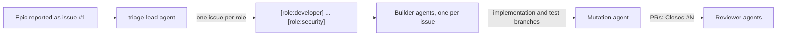

# Run the team demo

Run one epic on a private repository with a team of agents that work in parallel and deliver their work as pull requests (PRs).
The same run checks that credentials and tenants stay separate.

## Prerequisites

- The cluster is running, and the agent image is built (`.env.opencode`).
- The mock LLM (`05-mock-llm.sh`) and the git server (`09-git-server.sh`) are deployed.
- For real work, a real model endpoint (see [Use a real LLM endpoint](use-real-llm-endpoint.md) or [Ollama](run-team-demo-with-ollama.md)).

## Run it

```bash
scripts/main.sh team-demo        # or: scripts/10-team-demo.sh
scripts/main.sh team-demo-down   # clean up and scale the pool back to 1
```

## The epic

The epic is in [agents/epic.md](../../agents/epic.md): add configuration-file support to the Click library, which is the seed repository.
It needs a refactor of value resolution, new unit, functional and mutation tests,
and it must not hurt coverage, performance, security or design.
The epic lists the quality gate for each of those areas.

## How the epic starts

The trigger is an issue, as it would be in a real team.



1. The script creates issue #1 on `alpha/app` from `agents/epic.md`.
2. The `triage-lead` agent (`agents/triage-epic.md`) reads the issue and the code.
   It creates one issue per role, titled `[role:<name>] ...`.
   Each issue has scope, acceptance criteria, dependencies and risks.
   It also comments on issue #1 with the checklist.
3. The script lists the `[role:<name>]` issues and starts one agent per issue.
   The agent receives the epic, the team rules, its role file and its issue text, and must write `Closes #<issue>` in its PR.
   Only role names the script knows are started, so an agent cannot launch arbitrary tasks.
4. If the triage agent creates no role issues, the script creates them from a fixed plan in `scripts/issues.py` and says so.
   This happens with the canned mock LLM.

## The team

| Wave | Tenant | Task            | Role                                | Delivers (as a PR)                                  |
| ---- | ------ | --------------- | ----------------------------------- | --------------------------------------------------- |
| 1    | alpha  | `developer`     | Builder                             | The refactor and the feature in `src/click`         |
| 1    | alpha  | `quality`       | Builder (unit and functional tests) | `tests/test_config_*.py`, coverage before and after |
| 2    | alpha  | `mutation`      | Builder (mutation tests)            | Mutation setup, killing tests, surviving mutants    |
| 1    | alpha  | `docs`          | Builder (technical writer)          | The feature page, with real example output          |
| 1    | alpha  | `ux`            | Builder (UX designer)               | Help text and error wording                         |
| 1    | alpha  | `sre`           | Builder (SRE)                       | Failure-mode spec and tests                         |
| 1    | alpha  | `product-owner` | Builder (product owner)             | User stories and acceptance criteria                |
| 3    | alpha  | `principal`     | Reviewer                            | Design review comment on each PR                    |
| 3    | alpha  | `security`      | Reviewer                            | Security review comment on each PR                  |
| 3    | alpha  | `performance`   | Reviewer                            | Measured import and invocation cost                 |
| 0    | alpha  | `triage-lead`   | Triage agent                        | One `[role:<name>]` issue per role                  |
| 0    | alpha  | `ci-check`      | Plain shell (no LLM)                | A PR that proves the push and PR path works         |
| 0    | beta   | `triage`        | Read-only OpenCode agent            | A summary of beta's repository                      |

Wave 1 builders work at the same time, each on its own branch `epic/<role>`.
They can read each other's branches with `git fetch`, but only a PR changes the shared repository.
When those builders finish, the script frees their workers and runs mutation testing in wave 2,
so both implementation and test branches are available. Only the mutation task gets a larger
memory limit (`MUTATION_MEMORY`, default `2Gi`); other tasks inherit the workspace profile.
AX replaces a task's profile rather than merging it with the workspace profile, so the
mutation override includes both the image and the memory limit.
Its instructions limit mutmut to one worker and a three-minute run on explicitly selected code.
The role must stop after two failed mutmut attempts, and must not hide failing baseline tests
or patch the installed mutation tool to produce a score.
Timeouts and incomplete mutation scores must be reported as unverified, not passing.
After mutation finishes, the script frees its worker and starts the wave 3 reviewers.
The reviewers read the open PRs, run short checks, and post a verdict (`APPROVE` or `REQUEST_CHANGES`) on each one.
Nothing is merged: a person decides.

## How a role is defined

| File                                        | Content                                                               |
| ------------------------------------------- | --------------------------------------------------------------------- |
| `agents/epic.md`                            | The goal, requirements and quality gates. Sent to every epic role.    |
| `agents/_builder.md`, `agents/_reviewer.md` | How the team works: lane, branch, commits, tests, PR format, secrets. |
| `agents/<role>.md`                          | What this role owns, does and does not do, and when it is done.       |
| `agents/triage-epic.md`                     | The triage lead: roster, issue format and API calls.                  |
| `agents/ci-check.sh`                        | A shell script for an agent that needs no model.                      |

The script joins the files, base64-encodes the result into the task's `AGENT_PROMPT_B64` variable, and the task attaches it with `opencode run -f`.
To add a role, create `agents/<role>.md` and add the role to `BUILDERS` or `REVIEWERS` in `scripts/10-team-demo.sh`, and to the roster in `agents/triage-epic.md` and the plan in `scripts/issues.py`.
The worker pool reserves capacity from the initial task and builder roster (`WORKERS` overrides this),
and `EPIC_TIMEOUT` limits non-mutation waves (default 1800 seconds).
Mutation has a separate overall `MUTATION_TIMEOUT` (default 3600 seconds), including agent setup and reporting.
Tasks stay available after command completion for `HOLD_SECONDS` (default `3 * EPIC_TIMEOUT + MUTATION_TIMEOUT + 300`),
covering all waves and the final suspend/resume check. Run `team-demo-down` after collecting results,
including after a failed run.
The script prints each model-backed task's input, output, cache-read and cache-write token counts before deleting its task.
These are usage measurements; they are not savings comparisons without a matched baseline.

## How agents deliver work

- The git token has `write:repository` and `write:issue` scopes, and it stays outside the sandbox.
- The gateway replaces an `Authorization` header only when the request already has one.
  Git does this by itself. API calls, such as creating a PR, send `Authorization: token placeholder`.
- Each tenant's repository is recreated at the start of a run, so old branches and PRs do not carry over.

## Verified result

Historical run with the mock LLM, before mutation was separated into its own wave:

| Check                                         | Result                                                                               |
| --------------------------------------------- | ------------------------------------------------------------------------------------ |
| Both workspaces clone their private repo      | `Ready`                                                                              |
| 9 tasks of waves 0 and 1, then 3 of wave 2    | All reached `Working`, finished, and were collected                                  |
| Epic as issue #1, role issues, one agent each | The script created 10 role issues from the fixed plan and started one task per issue |
| Issue API from a sandbox                      | `ci-check` commented on issue #1 with the placeholder header                         |
| Push and PR creation from a sandbox           | `ci-check` pushed a branch, and PR #1 exists on `alpha/app`                          |
| Host outside the Gateway allowlist            | Refused (`ci-check` gets no response from `example.com`)                             |
| `/workspace` across suspend and resume        | Marker file survives                                                                 |
| LLM receives each tenant's own key            | `sk-tenant-alpha-KEY` and `sk-tenant-beta-KEY`                                       |
| Sandbox environment                           | `LITELLM_API_KEY=placeholder`, no git token                                          |
| `beta` clones `alpha/app` with its own token  | Workspace `Failed`                                                                   |

The mock LLM returns canned replies, so its role agents opened no feature PRs and did not verify the epic's quality gates.

### Real-provider recovered run: 2026-11-25

The [recorded results](../explanation/team-demo-2026-11-25.json) use `claude-sonnet-4-6`
through the configured internal gateway.

| Check                                         | Result                                                                        |
| --------------------------------------------- | ----------------------------------------------------------------------------- |
| Triage creates the ten role assignments       | Completed                                                                     |
| Six parallel builders                         | Completed                                                                     |
| Mutation sandbox memory                       | `2Gi` observed; no repeat of the earlier memory-limit crash                   |
| Mutation role                                 | Completed after cancelling an over-budget attempt and retrying only this role |
| Principal, security and performance reviewers | All completed                                                                 |
| Local pull requests                           | 8; 7 review comments: 6 `REQUEST_CHANGES`, 1 conditional `APPROVE`            |
| Git push, PR creation, issue read/comment     | Successful; HTTP 201 / 200 / 201                                              |
| Unlisted host                                 | Refused                                                                       |
| Suspend/resume                                | Exact marker preserved; asserted                                              |
| Cross-tenant clone                            | `Failed`, as required; asserted                                               |

This was a **recovered staged run**, not a clean single-command success.
The fresh orchestrator exited 1 when mutation exceeded its original 1800-second deadline.
After preserving its usage and stopping that attempt, a targeted mutation retry reused the existing
builder branches; the reviewer/final-check continuation exited 0.
The final script now gives mutation its own overall deadline and retains early tasks through all waves.
A new unattended run with all final changes has not yet been verified.

**The generated feature is not merge-ready.** The mutation agent reported 39 failed and 29 passed
combined developer/quality baseline tests, and 78 passing tests of its own.
It could not obtain a mutation score because mutmut imports its installed Click dependency before the
instrumented project Click. The score remains unverified; test associations are not a mutation score.
These test counts are agent-reported, not an independent rerun.
Not every PR received a review, and prompt-level stop instructions were not reliably followed.
Task completion therefore does not imply quality-gate approval.

See the [token findings](../explanation/token-saving-findings.md#full-team-runtime-check-2026-11-25)
for usage including the cancelled attempt. No whole-team savings percentage was measured.

## Related

- [Use a real LLM endpoint](use-real-llm-endpoint.md)
- [Run the team demo with Ollama](run-team-demo-with-ollama.md)
- [Enable token-saving tools](enable-token-saving-tools.md)
- [Host repositories on a git server](host-repositories-with-git-server.md)
