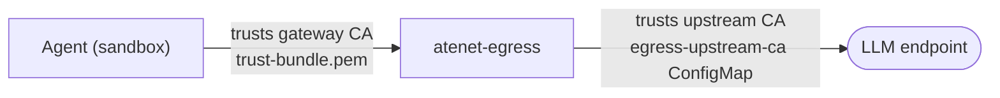

# Trust a private CA

Make the egress gateway accept an upstream endpoint whose certificate
comes from a private certificate authority (CA).

## Why this is needed

The egress Envoy validates upstream TLS against `/etc/ssl/certs/ca-certificates.crt` in its own image.
That bundle lacks private and corporate CAs.
`scripts/05-mock-llm.sh` replaces the file with a ConfigMap named `egress-upstream-ca` in `ate-system`.
The ConfigMap holds the container VM's CA bundle plus the mock CA.

Two separate trust links exist, and each needs its own CA:



This page fixes the second link.
The first is automatic once the runtime reads the bundle (see the last section).

## Steps

1. Build a bundle that includes your CA:

   ```bash
   podman machine ssh 'cat /etc/pki/ca-trust/extracted/pem/tls-ca-bundle.pem' > bundle.pem
   cat my-ca.pem >> bundle.pem
   ```

2. Replace the ConfigMap:

   ```bash
   kubectl -n ate-system create configmap egress-upstream-ca \
     --from-file=ca-certificates.crt=bundle.pem --dry-run=client -o yaml | kubectl apply -f -
   ```

3. Restart the egress gateway:

   ```bash
   kubectl -n ate-system rollout restart deployment atenet-egress
   ```

   If the deployment has a different name, run `kubectl -n ate-system get deploy` to find it.

## Trust inside the sandbox

The agent must trust the gateway, not your CA.
The platform mounts the gateway CA at `/run/ate/egress-trust-bundle/trust-bundle.pem`.
The OpenCode image sets `NODE_EXTRA_CA_CERTS` and `SSL_CERT_FILE` to that path.
For another runtime, set the equivalent variable.
