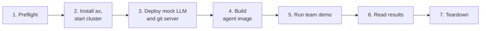

# Tutorial: run your first sandboxed task

In this tutorial, you start a local cluster and run a small team of agents for two tenants,
and prove that the sandboxes never see your API key or git token.
It takes about 15 minutes, most of it image downloads on the first start.

You use a mock LLM, so you need no real key.



## Before you begin

You need:

- macOS or Linux with Podman or Docker, and 6 GiB of RAM or more for the container VM
- `kind`, `kubectl`, `curl` and `envsubst`
- Network access to `ghcr.io` and `github.com`

Run every command from the project root.

## 1. Check your environment

```bash
scripts/00-preflight.sh --fix
```

The script checks your tools, container engine, memory and kernel.
With `--fix`, it resizes a Podman machine to 8 GiB of RAM and 4 CPUs.

## 2. Install the `ax` CLI and start the cluster

```bash
scripts/01-install-ax.sh
export PATH="$HOME/.ax/bin:$PATH"
scripts/02-start-cluster.sh
```

The first start pulls about 570 MB of images.
When it finishes, the cluster is ready to run sandboxed tasks.

## 3. Deploy the mock LLM

```bash
scripts/05-mock-llm.sh
scripts/09-git-server.sh
```

The first script deploys a TLS-enabled mock that speaks the OpenAI chat format
and makes the egress gateway trust its certificate.
The second deploys a git server that hosts each tenant's repository.

## 4. Build the agent image

```bash
scripts/03-build-push-image.sh
```

The script pushes the image to a registry on the `kind` network
and writes a digest-pinned reference to `.env.opencode`.

## 5. Run the team demo

```bash
scripts/10-team-demo.sh
```

The script creates two tenants, `alpha` and `beta`, each with a private repository.
It starts three OpenCode agents and one shell agent that work on those repositories.
This step takes a few minutes.

## 6. Read the results

Near the end of the output you see:

```text
mock-llm received Authorization: Bearer sk-tenant-alpha-KEY
...
blocked-host=000refused
...
LITELLM_API_KEY=placeholder
...
Phase:        Failed
```

- Each agent's request reached the LLM with its own tenant's real key, yet the sandbox holds only `placeholder`.
- The shell agent could not reach a host that is not in its Gateway.
- A `/workspace` marker file survived suspend and resume.
- `beta` could not clone `alpha`'s repository, so the last workspace is `Failed`.

The egress gateway replaced the placeholder and the git token after the requests left the sandbox.
See [Run the team demo](../how-to/run-team-demo.md) for the full table.

## 7. Clean up

```bash
scripts/99-teardown.sh
```

## What you learned

You ran several agents for two tenants, and you saw that real credentials reached the LLM and the git server
without ever entering a sandbox, and that one tenant cannot use another's.

## Next steps

- [Use a real LLM endpoint](../how-to/use-real-llm-endpoint.md)
- [Credential injection](../explanation/credential-injection.md)
